<p align="center">
  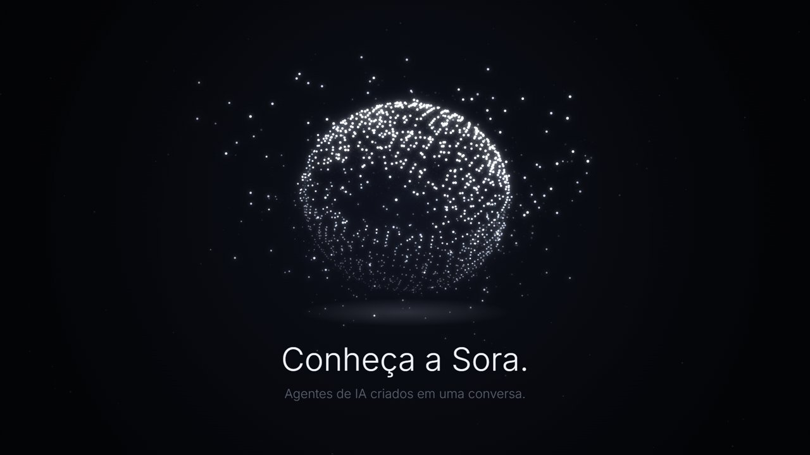
</p>

<h1 align="center">Sora</h1>

<p align="center"><strong>Sua ideia. Seus agentes. Tudo em uma conversa.</strong></p>

<p align="center">
  Plataforma de <strong>bots de IA criados por conversa</strong>: você descreve o que precisa, a Sora monta
  o bot (ou um grupo de bots), coordena o trabalho e pede a sua aprovação antes de qualquer ação que mexa no mundo.
</p>

---

## O que é

A **Sora** é a chefe de equipe. Você conversa com ela em português, ela cria **bots** com nome, função,
cor, ferramentas e rotina, e junta de 2 a 5 bots em **grupos** para trabalhos maiores. Os bots pesquisam
na web, navegam em sites, leem arquivos, lembram de você, trabalham em horários marcados e, no app de
desktop, podem usar o seu computador. **Nada é enviado, comprado ou publicado sem você aprovar** no
cartão "Precisa de você".

Cada pessoa usa **a própria chave de API** (OpenAI, Anthropic, Groq, Gemini, OpenRouter, servidor
compatível com OpenAI ou Ollama), guardada cifrada no servidor e nunca no navegador.

<p align="center">
  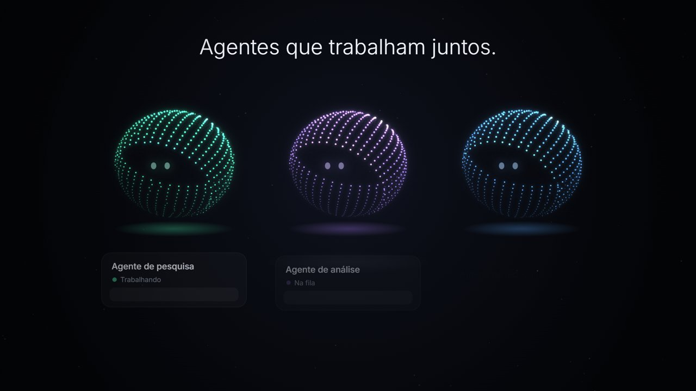
</p>

## Telas

| Início: converse com a Sora | Novo bot por descrição |
|---|---|
| 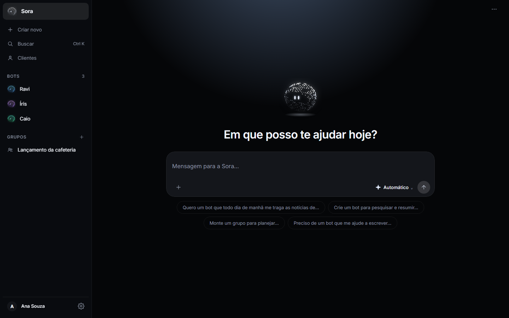 | 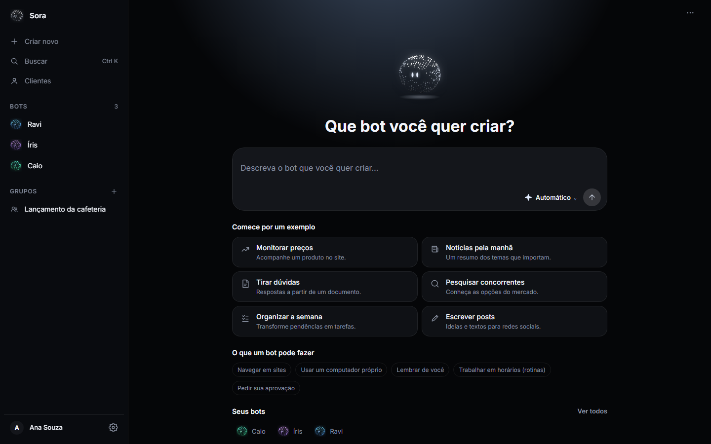 |
| **Rascunho do bot: você ajusta e confirma** | **Recursos de um bot** |
| 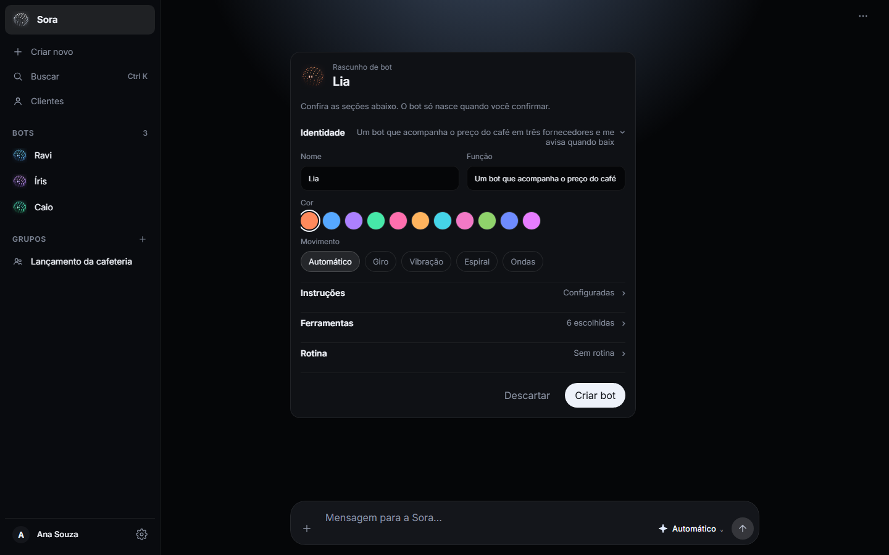 | 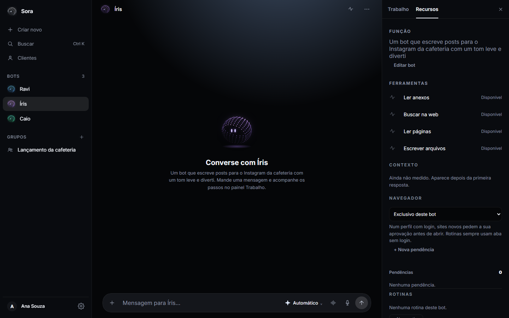 |
| **Grupo com a Sora como chefe de equipe** | **Modelos de IA: cada um usa a própria chave** |
| 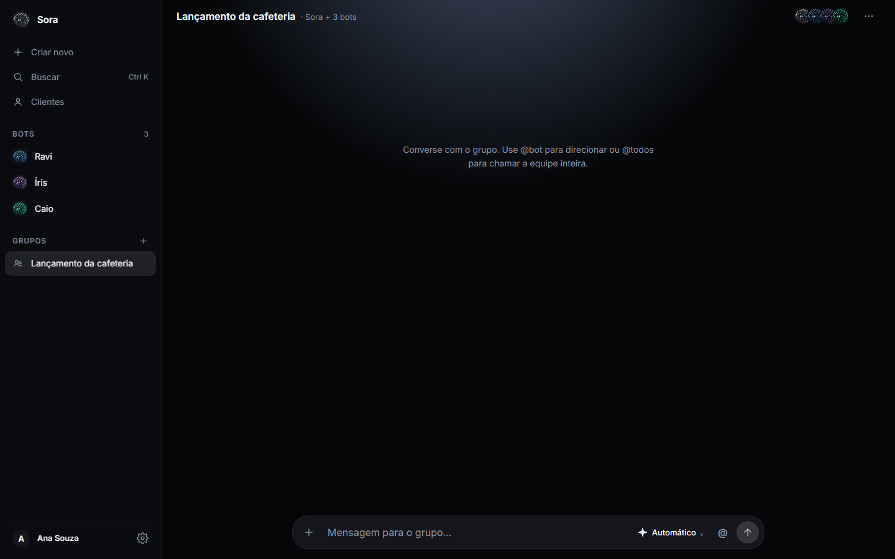 | 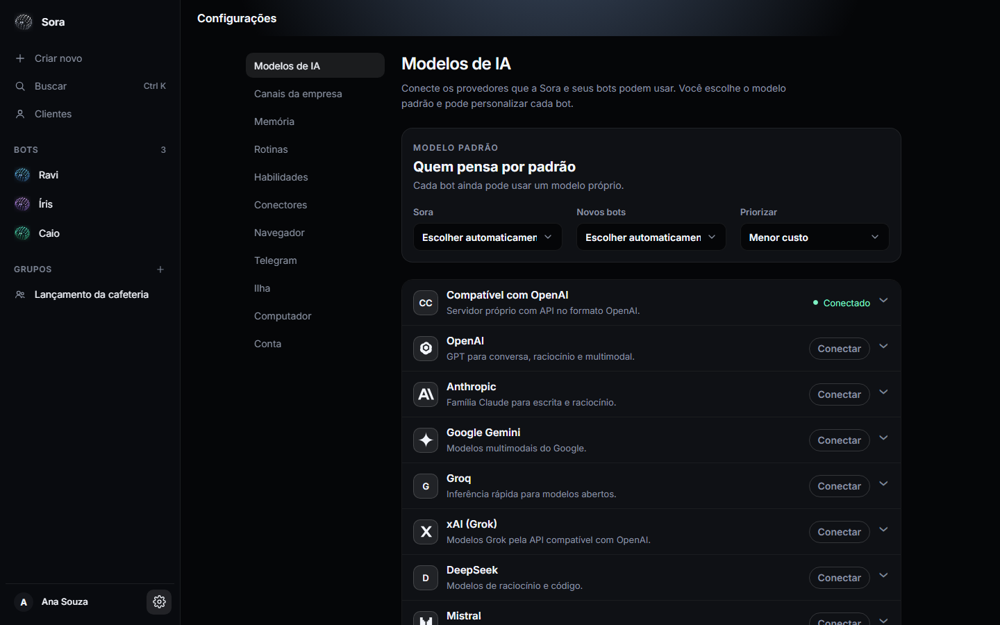 |

<p align="center">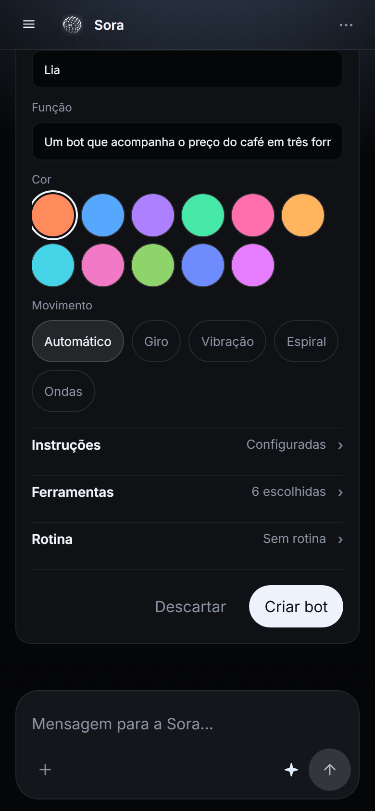</p>

> Prints gerados por `app/qa/readme-fotos.mjs` com uma conta de demonstração e o modelo falso.

## Recursos

| | |
|---|---|
| **Bots e grupos** | Criação por conversa (cartão de rascunho) ou direto em "Novo bot"; grupos de 2 a 5 bots com a Sora coordenando; `@bot` e `@todos`. |
| **"Precisa de você"** | Toda ação com efeito fora da Sora vira cartão: Permitir uma vez, Sempre permitir (quando seguro) ou Recusar. Modos Perguntar, Automático e Acesso total. |
| **Navegador do bot** | Chromium do próprio servidor (Playwright), lido como árvore de acessibilidade com refs; clica, digita, rola, segue abas novas e entra em iframes. Perfis com login cifrado; site novo em perfil logado pede aprovação. |
| **Controle do PC** (desktop) | Ponte em Rust no app Tauri: captura de tela, UI Automation, mouse e teclado; um bot por vez, borda acesa, Parar sempre visível, mexer no mouse pausa; terminais, senhas, macros e a própria Sora bloqueados. |
| **Memória, rotinas e habilidades** | O bot lembra de você (editável), roda em horários marcados (só com ferramentas seguras) e aprende habilidades aprovadas por você. |
| **Canais da empresa** | Slack e WhatsApp Business **só leitura**: fichas de clientes, base de conhecimento sem dado pessoal e sugestões de melhoria (LGPD: máscara, retenção, "apagar tudo deste cliente"). |
| **Voz, imagens e arquivos** | Ditado e conversa por voz, visão de imagem anexada, arquivos na resposta. |
| **Ilha da Sora** | Pílula flutuante no desktop mostrando quem está trabalhando, fora do app. |

## Arquitetura

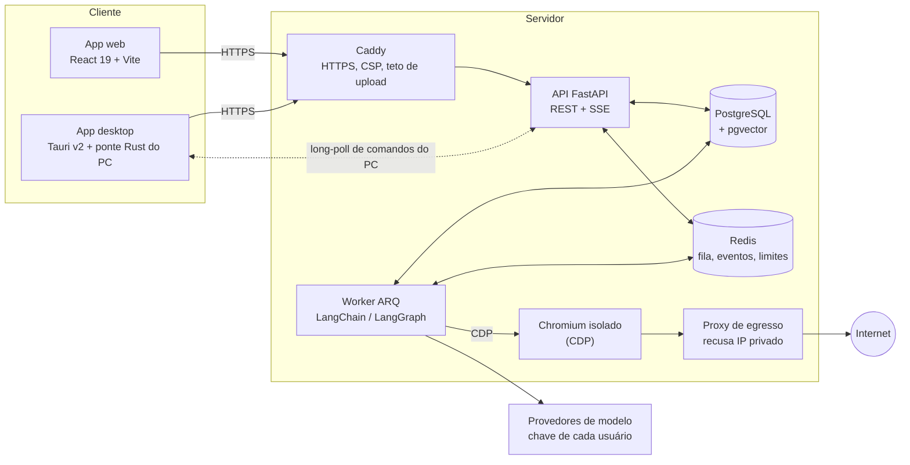

Fluxo de um pedido:

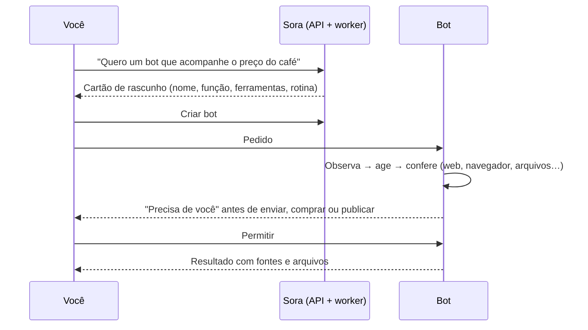

## Estrutura

```text
app/          front-end React 19 + Vite + TypeScript; app de desktop em app/src-tauri (Tauri v2, Rust)
backend/      API FastAPI, worker ARQ e bots em LangChain (Python 3.12, uv)
  app/        api, core, modelos, eventos, llm, seletor, agentes, ferramentas, navegador,
              computador, revisor, memoria, rotinas, canais_empresa…
  workers/    jobs da fila
  prompts/    um .md por prompt, com versão no nome
  migrations/ Alembic
  tests/      unitarios, integracao (Postgres e Redis reais), contrato, ponta_a_ponta
infra/        docker-compose.yml, Caddyfile, proxy de egresso, scripts de backup
docs/         plano de implementação, design, computador por bot, canais da empresa
log/          diário da equipe (comece por log/ONDE-PARAMOS.md)
```

## Como rodar

**App** (Node.js 20+):

```bash
cd app
npm install
npm run dev            # http://localhost:5173
npm run desktop        # app de desktop (precisa de Rust)
```

**Backend** ([uv](https://docs.astral.sh/uv/) e Docker):

```bash
cd backend
uv sync --python 3.12
uv run alembic upgrade head
uv run uvicorn app.main:app --reload     # API em :8000
uv run python -m workers                 # worker
```

Copie `infra/.env.exemplo` para `.env` e preencha os segredos (`CHAVE_MESTRA`, `JWT_SEGREDO`,
`REDIS_SENHA`…). **Nunca** coloque chave ou senha no repositório. Para desenvolver sem gastar cota,
`SORA_MODELO_FALSO=1` responde com respostas prontas (o servidor recusa subir assim em produção).

**Testes:**

```bash
cd backend && uv run ruff check . && uv run pytest tests/unitarios
cd app && npm run build && npx oxlint && npm test
cd app/src-tauri && cargo clippy -- -D warnings && cargo test
```

O CI (`.github/workflows/ci.yml`) roda tudo isso, mais a integração com Docker, a cada push e PR.

## Segurança e privacidade

- Senhas com argon2id; chaves de API cifradas com AES-GCM (rotação de chave mestra); token de acesso
  de 15 min com revogação ao sair; renovação com detecção de reuso.
- Navegador e computador isolados, com saída só pelo proxy de egresso (sem rede interna nem metadados
  da nuvem); proteção SSRF em toda leitura de página.
- Defesa contra prompt injection: depois de ler conteúdo de fora, o modo "Acesso total" volta a pedir
  aprovação para ações de risco.
- LGPD: apagar a conta remove os dados de todas as tabelas, arquivos e eventos.

## Estado e próximos passos

| Parte | Estado |
|---|---|
| App web e desktop | Funcionando com o backend real (REST + SSE). |
| Backend | Conversas, bots, grupos, navegador, PC, memória, rotinas, canais da empresa, voz. |
| Infra | Docker Compose pronto (Caddy, API, worker, Postgres, Redis, navegador isolado); deploy a fazer. |
| **Computador virtual por bot** | **Meta, ainda em projeto**: cada bot com um computador Linux próprio e isolado (`docs/computador-por-bot.md`). |

Próximos passos: deploy; escala do navegador (vários contêineres com fila e cota por plano) e da busca
na web (cota por usuário); domínio real no CSP do app de desktop e instalador assinado; computadores
virtuais em hosts separados.

Detalhes do plano em [`docs/plano-de-implementacao/`](docs/plano-de-implementacao/README.md) e o
diário da equipe em [`log/`](log/ONDE-PARAMOS.md).
