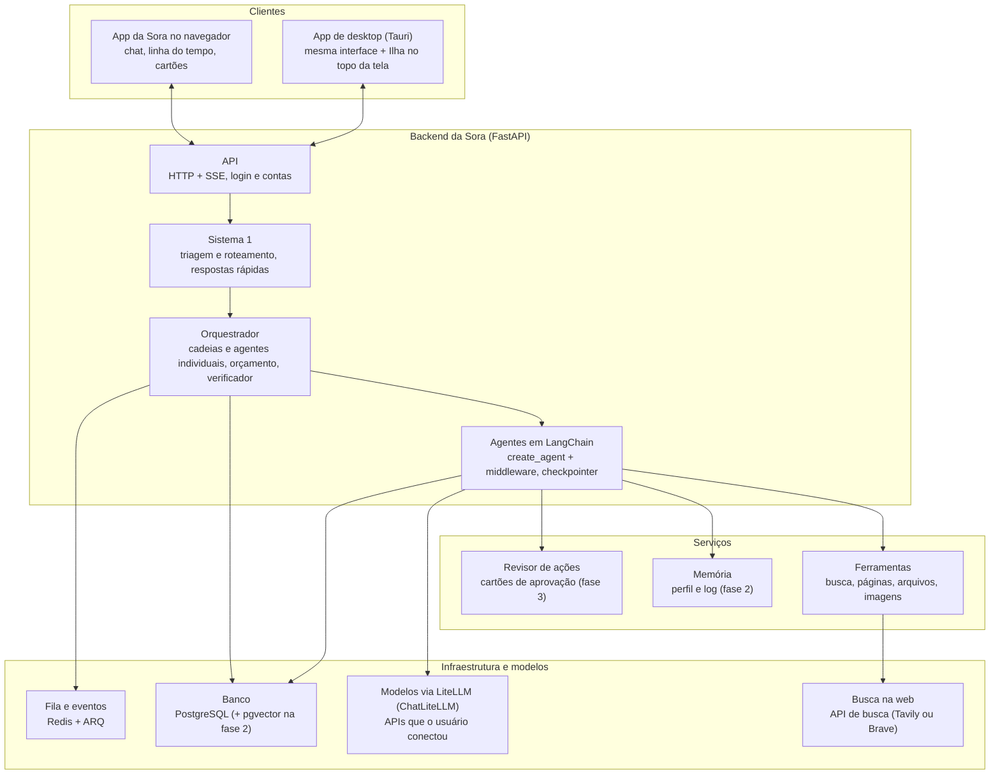
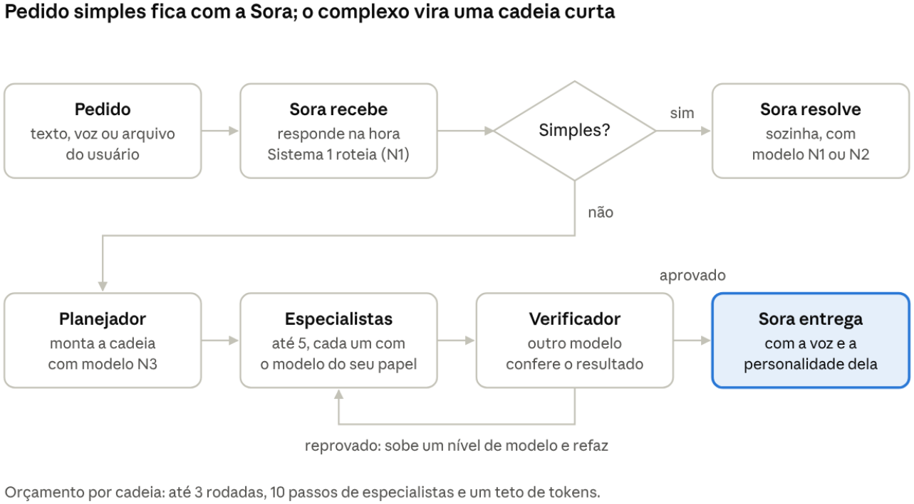

# Sora: plano de implementação

Oct 11, 2026 · @Heitor · **versão 2.1** (versão 2 revisada para combinar com o app; na 2.1, de 2026-10-14, os agentes passam a ser feitos em LangChain. O que mudou está no [README](README.md))

A Sora é uma agente principal com personalidade própria. Ela resolve pedidos sozinha ou montando outros agentes, e um modelo rápido (o Sistema 1) escolhe, entre as APIs que o usuário conectou, o modelo certo para cada tarefa. Este documento define o que vamos montar e como.

A especificação técnica da fase 1 está em [Especificação do backend](02-especificacao-do-backend.md) e os prompts em [Prompts](03-prompts.md).

## Ponto de partida: o que já existe

O **app** (front-end) já está pronto em `app/`: React 19 + Vite + TypeScript, rodando no navegador e como **programa de desktop** (Tauri v2, em `app/src-tauri`). Hoje tudo nele é **simulado** por um relógio (`app/src/state/projetos.ts`). O backend deste plano substitui a simulação por dados reais, e a simulação continua existindo como **modo demonstração** (sem internet e sem API, útil na FEBRACE).

O que o app já mostra e o backend precisa alimentar:

| No app | O que é no backend |
| --- | --- |
| Novo chat com o seletor **Equipe \| Agente independente** | Pedido para a Sora (o Sistema 1 decide entre direto e cadeia) ou criação de um agente individual |
| Pasta do projeto em CHATS, com os agentes dentro | Conversa do tipo `projeto` com a sua cadeia; os agentes da pasta são os especialistas da cadeia |
| Agente solto em CHATS | Agente individual, com chat próprio |
| Painel **Trabalho** (prompt, ferramentas com parâmetros e resultado, repasses) | Eventos `passo` de cada etapa |
| Plano com tarefas e progresso | `cadeia.criada` e `etapa.atualizada` |
| **Revisão** (Aprovar / Pedir ajuste, com comparação de versões) | Tabela `entregas` com versões; rotas de aprovar e de ajuste |
| **Ilha da Sora** no topo da tela (agentes rodando em todos os projetos) | Canal de eventos do usuário (todas as conversas) |
| Configurações → Modelos de IA | Rotas de provedores e modelos (as chaves saem do navegador) |

## Arquitetura

O app conversa com a API em tempo real. O Sistema 1 faz a triagem de cada pedido e o orquestrador monta cadeias ou aciona agentes individuais. Cada agente (a Sora, os especialistas e os individuais) é montado em LangChain. O trabalho longo roda na fila, fora da requisição. Celular e gatilhos externos (webhooks) entram nas fases 3 e 4.

## Fluxo de um pedido

*fluxo de um pedido · 8 etapas, 2 decisões*

A Sora responde na hora e o Sistema 1 decide se ela resolve sozinha. Se o pedido for complexo, um planejador monta uma cadeia curta, os especialistas executam e um verificador confere antes de a Sora entregar. Depois da entrega, o usuário **revisa**: aprova ou pede ajuste (o ajuste gera uma nova versão das entregas).

Quando o usuário escolhe **Agente independente** no Novo chat, a escolha dele vale como o "sim" para criar um agente: o Sistema 1 não decide o modo, a Sora cria o agente a partir do pedido e o agente já começa a trabalhar no chat dele.

### Os dois modos

|  | Modo Cadeia (no app: **Equipe**) | Modo Agentes individuais (no app: **Agente independente**) |
| --- | --- | --- |
| Para quê | Resolver um pedido complexo de uma vez | Papéis que se repetem, como finanças ou estudos |
| Quanto dura | A cadeia termina com o pedido; os especialistas ficam visíveis na pasta do projeto, mas não trabalham fora dela | Fica vivo, com nome e chat próprio (memória e rotinas na fase 2) |
| Quem fala com o usuário | Só a Sora | O próprio agente, num chat dele |
| Como aparece no app | Pasta do projeto em CHATS, com os especialistas dentro (nome, cor e movimento próprios) | Linha solta em CHATS e na galeria Agentes |
| Modelos | O planejador escolhe um por etapa (N1 a N3) | Um modelo padrão por agente, que sobe de nível quando precisa |
| Limite | Até 5 especialistas, 3 rodadas, 10 passos | Até 5 agentes por usuário; só o usuário apaga |

O que liga os dois modos:

- **Mesma personalidade:** todo agente individual herda o prompt base da Sora e acrescenta só o próprio nome e papel.
- **Promover um especialista:** na pasta do projeto, "Salvar como agente" transforma um especialista em agente individual (aí ele passa a contar no limite de 5).
- **Cadeia dentro do individual:** um agente individual pode disparar uma cadeia quando a tarefa ficar complexa (fase 2).
- **A Sora coordena todos:** ela vê os agentes, sugere criar um novo quando um pedido se repete e só cria com o "sim" do usuário.

## Roteador Sistema 1

Um modelo pequeno e rápido, o Sistema 1, lê todo pedido primeiro. Ele resolve sozinho o que é simples e decide para onde vai o resto. Os modelos maiores (Sistema 2) só entram quando o pedido precisa deles. A Sora roteia por papel e por dificuldade.

**As APIs são do usuário.** Ele conecta as que quiser (Groq, OpenAI, Anthropic, Google, OpenRouter, Ollama ou qualquer API compatível com a da OpenAI) e paga cada uma direto. O Sistema 1 decide o nível e as capacidades que o pedido precisa. Depois, um seletor escolhe entre os modelos conectados o melhor para aquele nível, pela prioridade do usuário: custo, velocidade ou qualidade. Se um provedor falhar, o seletor passa para o próximo. Os detalhes estão na seção 5 de Especificação do backend.

**Sem API conectada**, o app funciona só no **modo demonstração** (a simulação de hoje). Pedidos reais exigem pelo menos uma API validada.

**Laya, a versão rápida do Sistema 1.** Na fase 1, a triagem é feita pelo modelo N1, e cada decisão é gravada como dado de treino (custa só uma linha no banco). Na fase 2, treinamos o Laya, um modelo aberto de decisão que responde em dezenas de milissegundos, e ele roda em modo sombra ao lado do N1. Na fase 3, o Laya passa a decidir quando está confiante, e o N1 fica com o resto e com as respostas em texto. O Laya é **opcional**: é um projeto pequeno, de um autor só, e a Sora funciona igual sem ele. Detalhes na seção 7 de Especificação do backend.

O que o Sistema 1 devolve para cada pedido, em JSON validado com Pydantic:

| Campo | Exemplos | Para que serve |
| --- | --- | --- |
| modo | direto, cadeia, agente individual | Escolhe o caminho do pedido |
| dificuldade | 1, 2 ou 3 | Escolhe o nível do modelo |
| especialistas | Pesquisador, Redator, Designer | Monta a cadeia |
| superfície | memória, conector, web, navegador | Aplica a escada de tentativas |
| risco | nenhum, ação externa, destrutivo | Liga o revisor de ações antes de agir |
| idioma | pt-BR | Mantém a resposta no idioma do usuário |
| confiança | 0 a 1 | Abaixo do limite, passa a decisão para o Sistema 2 |
| capacidades | ferramentas, visão, contexto longo, imagem | Filtra os modelos conectados que conseguem fazer a tarefa |

O que o Sistema 1 faz sozinho para deixar a Sora mais rápida:

- Manda a primeira resposta na hora ("Beleza, já estou olhando") enquanto o Sistema 2 começa a trabalhar em paralelo.
- Responde saudações, conversa curta e perguntas simples sem chamar modelo grande.
- Cuida das tarefas de fundo: título da conversa, sugestões de próximo pedido, detecção de idioma e resumo de contexto (proposta de memória na fase 2).
- Escolhe a superfície mais barata: um conector antes de abrir o navegador.
- Reaproveita respostas recentes quando o pedido se repete (cache).
- Roda os subagentes de navegador no ciclo "ver e agir", com raciocínio desligado (fase 3).

Os níveis de modelo:

| Nível | Papel | Exemplo, entre as APIs do usuário |
| --- | --- | --- |
| N0, sem modelo | Comandos fixos e respostas em cache | Regras em código |
| N1, Sistema 1 | Triagem, roteamento e todas as tarefas rápidas acima | Um modelo pequeno e rápido, como o gpt-oss-20b no Groq, ou um modelo local no Ollama |
| N2, Sistema 2 | Conversa da Sora, a maioria dos especialistas e os agentes individuais | GPT-5.6 Terra, Claude Sonnet 5.5, Gemini 3.8 Flash ou gpt-oss-120b no Groq |
| N3, Sistema 2 forte | Planejador, código, raciocínio difícil, segunda tentativa após reprovação | GPT-5.6 Sol, Claude Opus 5.5, Gemini 3.1 Pro, Grok 4.7 ou DeepSeek V4 Pro |

Regras de escalada:

- Se a confiança do Sistema 1 for baixa, a decisão sobe para o Sistema 2.
- Se o Verificador reprovar, a etapa sobe um nível e é refeita uma vez.
- O Verificador usa um modelo diferente do que executou a etapa.
- Se a cadeia bater no teto de custo, ela para e a Sora pergunta ao usuário.
- O Sistema 1 nunca entrega sozinho o resultado de uma tarefa complexa: ele só faz a triagem.
- A política (qual nível cada papel usa) fica num arquivo de configuração. Os modelos concretos vêm das APIs que o usuário conectou.

## Regras da cadeia e coordenação entre agentes

Poucos agentes, cada um com papel fixo, e travas que impedem os agentes de se acordarem sem parar.

Três regras que definem a Sora:

1. **A Sora é a única voz.** No modo cadeia, só ela fala com o usuário, por uma ferramenta de fala própria. O texto comum do modelo é raciocínio interno e nunca aparece para o usuário. Os especialistas devolvem o resultado para ela. **O trabalho deles é visível** (painel Trabalho: buscas, páginas lidas, arquivos, repasses), mas não é uma conversa: quando o usuário manda uma mensagem a um especialista pela pasta ou pela Ilha, ela vira uma correção de rota (`mensagem_especialista`) e quem responde é a Sora.
2. **Poucos agentes, papel fixo.** No máximo 5 especialistas por cadeia. Na fase 1: **Pesquisador, Redator, Designer** (só quando o usuário conectou um modelo que gera imagem) e **Verificador**. Analista de dados e Executor de automações entram na fase 3. Especialistas não criam outros agentes.
3. **Cada cadeia tem orçamento.** No máximo 3 rodadas, 10 passos de especialistas e um teto de custo em tokens.

**Cara dos especialistas no app.** Cada especialista de uma cadeia ganha nome, cor e movimento (como Atlas, Luna e Nina hoje), escolhidos por código: nome livre da lista, cor livre da paleta (nunca o `#E2ECFF` da Sora) e movimento pelo papel. A função mostrada é o papel ("Pesquisa e referências", "Textos e planejamento", "Criação visual").

Como os agentes conversam:

- **Ferramentas:** `enviar_para_agente` manda mensagem a outro agente, `criar_agente` cria um novo (só a Sora, e com aprovação do usuário) e `atualizar_agente` edita nome e papel. Não existe ferramenta para apagar: só o usuário apaga.
- **Mensagens assíncronas:** a mensagem acorda o destinatário num turno novo. Quem enviou não fica esperando.
- **Prioridade:** uma mensagem marcada como prioritária interrompe o trabalho do outro agente, como um "pare agora".
- **Subagentes da cadeia:** a Sora dispara o especialista em segundo plano. Ela pode ver o status (`ver_especialista`), corrigir a rota (`mensagem_especialista`) e cancelar (`parar_especialista`).

Travas da coordenação:

| Trava | Valor |
| --- | --- |
| Rodadas por pedido | 3 |
| Passos de especialistas por pedido | 10 |
| Mensagens por agente em cada rodada | 2 |
| Histórico compartilhado no prompt | últimas 24 mensagens |
| Ordem de fala | rodízio, começando por um agente diferente a cada rodada |
| Agente sem nada a acrescentar | responde "pass" e fica calado |
| Usuário mencionou alguém com @ | só os mencionados respondem |

Regras de comportamento:

- Um agente só manda mensagem a outro quando isso ajuda o usuário.
- Mandar para vários agentes ao mesmo tempo exige pedido explícito do usuário.
- Agentes não trocam "ok" entre si.
- Uma mensagem de outro agente nunca tem a autoridade do usuário.

## Revisão e versões

O app já tem a tela de Revisão; o backend passa a guardar as entregas de verdade.

- Cada especialista entrega pela ferramenta `entregar`. A entrega vira uma linha em `entregas` (tipo texto, links, imagem, calendário ou arquivo) com o número da versão.
- Quando a cadeia termina, o projeto fica **pronto para revisar** e a Sora avisa (e a Ilha abre na vista Aprovação).
- **Aprovar** marca a versão como aprovada. Na fase 1 não existe publicação automática: "Aprovar e publicar" só vira publicação de verdade quando houver conectores (fase 3). Até lá, o botão se chama **Aprovar**.
- **Pedir ajuste** abre uma nova rodada só com o especialista certo e gera a versão seguinte; a tela compara as duas.

## Personalidade e voz da Sora

A personalidade da Sora é montada em camadas, e todo agente individual herda a camada base. Assim a Sora soa igual em qualquer agente.

As camadas do prompt, da mais fixa para a mais variável:

1. **Prompt base da Sora:** personalidade, tom, ritmo de turno e regras de segurança. É igual para todos os agentes.
2. **Perfil do agente:** nome e papel. Quando o perfil muda, entra uma mensagem oculta de atualização em vez de reescrever o prompt base, o que preserva o cache do prompt e reduz o custo.
3. **Memória** do usuário e lista de agentes disponíveis (memória a partir da fase 2).
4. **Estilo do usuário:** a Sora imita o jeito de escrever da pessoa e responde no idioma dela.

O ritmo de cada turno:

1. Responder primeiro, antes de qualquer ferramenta, nem que seja "Beleza, já estou olhando".
2. Escolher onde trabalhar, do mais barato para o mais caro (escada de tentativas).
3. Trabalhar dando notícias a cada passo importante, sem sumir e sem narrar cada comando.
4. Mostrar a prova: print, arquivo ou link.
5. Fechar com o resultado. Um "já vou fazer" no começo não conta como entrega.

Regras de tom:

- Falar como uma amiga competente, não como central de atendimento: nada de "Certamente!" ou "Fico feliz em ajudar".
- Respostas curtas, em várias bolhas, como mensagens de texto. Listas e títulos só quando o usuário pede.
- Emoji só se o usuário usar.
- Nunca inventar números ou fontes. Sem dado, a Sora diz que não tem e oferece o caminho real.
- Decidir sozinha por padrão. Perguntar só quando a ação é irreversível ou o pedido é realmente ambíguo, sempre com um cartão de opções.

## Memória (fase 2)

A memória é reescrita em segundo plano pelo Sistema 1, e um segundo modelo audita cada mudança antes de salvar. O usuário vê e corrige tudo numa tela própria.

Como funciona:

1. **Coleta:** depois de cada turno, o par pergunta e resposta vira uma "evidência" com id. Cada lado é cortado em 8.000 caracteres, e ficam no máximo 12 evidências por agente na fila.
2. **Espera:** a síntese roda 15 segundos depois da última evidência, com prazo de 90 segundos e até 3 tentativas.
3. **Síntese:** o Sistema 1 recebe a memória atual e as evidências novas. Ele devolve mudanças em JSON (criar, atualizar ou remover), e cada uma precisa citar os ids das evidências que a justificam.
4. **Verificação:** outro modelo responde só `{"approved": true/false}`. Se reprovar, nada é salvo.
5. **Revisão de datas:** uma vez por dia, fatos com data são revistos (um plano passa para o passado). O sistema nunca inventa se o plano aconteceu.

Regras:

- Dois tipos de memória: **perfil** (quem a pessoa é, preferências, restrições) e **log** (projetos, decisões, planos com data).
- Guardadas no PostgreSQL (tabela `memorias`) e exportáveis em Markdown legível: um `perfil.md` e um arquivo de log por dia, por agente.
- Busca semântica com **pgvector** no próprio PostgreSQL (sem um serviço a mais).
- Cada memória tem no máximo 500 caracteres.
- O que o usuário mandou lembrar explicitamente fica travado: a síntese não altera nem apaga.
- Não inferir dados sensíveis nem fatos não ditos, e preservar a incerteza.
- Memória não é fonte de verdade: antes de uma decisão importante, o agente consulta a fonte de novo.
- Memória em camadas: a do usuário, compartilhada pela Sora e pelos agentes individuais, e as notas próprias de cada agente.

## Segurança e aprovações

Antes de qualquer ação com efeito fora da conversa, um revisor automático decide se ela pode rodar. A maioria passa sem o usuário perceber, e o que é arriscado vira um cartão de aprovação. Na fase 1 as ferramentas não têm efeito externo (buscar, ler, escrever na pasta da cadeia, gerar imagem), então o revisor entra de verdade na fase 3, junto com conectores e navegador. A tabela e o cartão já existem desde a fase 1 para `criar_agente`.

O revisor passa por comandos de terminal, chamadas de conectores, ações no navegador e no computador, criação de rotinas e agentes. Ele preenche campos fixos, nesta ordem:

1. `dano`: nenhum, efeito externo (enviar, publicar, comprar), vazamento de dados ou credenciais, perda de dados, comprometer a máquina, ou regra de bloqueio do usuário.
2. `quem_recebe`: a pessoa, o canal ou a URL que recebe o efeito. Se não dá para nomear ninguém, não é efeito externo.
3. `destino`: confiável ou não autorizado.
4. `decisao`: PERMITIR ou BLOQUEAR.

Quando bloqueia, o agente pode repetir a mesma ação, sem mudar nada, pedindo aprovação. Isso gera um cartão com "Permitir uma vez", "Sempre permitir" e "Negar". Cartões de tarefas em segundo plano expiram em 10 minutos. É proibido contornar um bloqueio, por exemplo codificando o comando, renomeando ou usando outra rota. A autoridade só vem do usuário, nunca de outro agente, de uma página ou de uma rotina.

Outras proteções:

- **Cerca de dado não confiável:** todo conteúdo da web ou de conectores entra no prompt dentro de uma tag que o marca como dado. Se esse texto pedir uma ação, o agente só avisa o usuário.
- **Parser de comandos:** cada comando de terminal é analisado antes de rodar (fase 3).
- **Pastas protegidas:** os agentes não leem nem escrevem nas pastas internas da Sora, nem por atalhos.
- **Segredos:** viram `[REDACTED]` nas saídas, e o modelo só vê o nome do segredo.
- **Chaves de API fora do navegador:** o app manda a chave uma vez para o backend e nunca mais a vê (hoje o app guarda as chaves no `localStorage`; isso acaba quando o backend entrar).
- **Permissões por agente:** cada especialista e cada agente individual recebe só as ferramentas e credenciais do seu papel.
- **Registro de ações:** todo efeito externo fica guardado com data, agente e motivo.

## Navegador e computador (fases 3 e 4)

A Sora nunca clica sozinha: ela delega o navegador e a tela a subagentes rápidos e acompanha o trabalho por prints.

- **Computador na nuvem:** um container Linux por usuário, com navegador (Playwright), terminal e uma pasta de trabalho que não se apaga. Os logins dos sites ficam salvos ali.
- **Subagentes de navegador e de computador:** usam modelo rápido com raciocínio desligado. A Sora checa se eles travaram, corrige a rota ou cancela.
- **Ferramentas do navegador:** navegar, clicar, digitar, preencher, rolar, trocar de aba, tirar print e um `snapshot` com a lista dos elementos clicáveis, mais barato que ler um print.
- **Escada de tentativas**, da mais barata para a mais cara:
  1. O que já tem (memória, arquivos, a própria conversa).
  2. Um conector MCP, mesmo que precise instalar.
  3. A web aberta.
  4. O navegador com login salvo.
  5. A tela do computador.
  6. Devolver a etapa ao usuário.
- **Passagem segura:** em login, 2FA, captcha ou pagamento, o agente pausa e o usuário assume a tela. O agente nunca vê a senha.
- **Detector de bloqueio:** reconhece páginas de captcha e de verificação anti-robô, para de tentar e chama o usuário.
- **Ensinar mostrando:** o usuário grava a tela fazendo a tarefa (até 10 minutos) e a Sora transforma a gravação num rascunho de skill.
- **PC do usuário pelo app de desktop:** o app Tauri já instalado no PC é o caminho para a Sora rodar comandos e ler arquivos locais, sempre com aprovação a cada comando. É também por ele que a Ilha pode mostrar agentes externos que rodam no PC (Claude Code, Codex, Hermes), como faz o Coucou.

## Peças de engenharia

Soluções pequenas para problemas que todo agente tem. Cada linha é um módulo do backend; quase todas viram middleware do LangChain (seção 6.1 da especificação).

| Peça | Como funciona na Sora |
| --- | --- |
| Lembretes automáticos | Um middleware conta as chamadas de ferramenta sem mensagem ao usuário. Depois de 6, injeta um lembrete para a Sora dar notícia. Outro lembrete entra se o turno começar sem resposta. |
| Metas de vários turnos | A meta não pode encolher para caber no turno. Só é marcada como concluída depois de o Verificador auditar cada requisito com evidência. |
| Resumo de contexto | Quando a conversa enche, o Sistema 1 resume. Plano da cadeia, tarefas, skills e perfil da Sora são recolocados depois do resumo. |
| Saídas grandes em arquivo | Resultados longos de terminal ou conector são salvos em arquivo, e o modelo recebe só o caminho. |
| Conserto de JSON | Se o modelo errar os argumentos de uma ferramenta, o sistema tenta consertar e revalidar com Pydantic antes de devolver erro. |
| Prazos por etapa | Cada ferramenta tem um teto de tempo, de 5 minutos a 2 horas conforme o tipo. |
| Detector de loop | Interrompe o turno quando o modelo repete a mesma linha ou o mesmo bloco várias vezes. |
| Passos visíveis | Cada chamada de ferramenta de um especialista vira um evento `passo` com rótulo legível ("Buscando: cafeterias no bairro"), parâmetros e resultado resumido: é o que o painel Trabalho e a Ilha mostram. |
| Rotinas e gatilhos | Por horário (cron ou intervalo) ou por evento (webhook, mensagem). A rotina fica calada quando não há novidade. |
| Primeiro turno | Um agente individual novo se apresenta sozinho e já começa a trabalhar se o papel dele tiver uma tarefa. |
| Sugestões de próximo pedido | O Sistema 1 sugere o próximo passo e as skills do usuário pelo nome. |
| Cartões de pergunta | Opções clicáveis, com resposta livre opcional. Uma pergunta por vez. |
| Agentes de manutenção | Quando o disco enche, por exemplo, nasce um agente que só inspeciona e propõe um plano antes de apagar algo. |
| Notificações | No desktop, notificação do sistema pelo app Tauri quando uma cadeia termina ou há aprovação pendente (fase 2). Push no celular na fase 4. |

## Stack

Backend em Python, com bibliotecas abertas. Os nomes dos modelos ficam fora do código, no arquivo de configuração.

| Camada | Escolha | Para quê | Fase |
| --- | --- | --- | --- |
| API | FastAPI + Uvicorn, com SSE | Receber pedidos e transmitir as mensagens da Sora em tempo real | 1 |
| Agentes | **LangChain 1.x** (`create_agent`, sobre o LangGraph) + `langgraph-checkpoint-postgres` | Laço de cada agente, ferramentas, saída estruturada, middleware e pausa/retomada das etapas | 1 |
| Modelos | LiteLLM, ligado ao LangChain pelo `langchain-litellm` (`ChatLiteLLM`) | Uma interface única para as APIs que o usuário conectar, com a chave dele em cada chamada | 1 |
| Validação | Pydantic | Saídas JSON do Sistema 1, do revisor e das ferramentas | 1 |
| Tarefas de fundo | ARQ com Redis (atrás de uma função `enfileirar` nossa) | Rodar cadeias, síntese de memória e rotinas fora da requisição | 1 |
| Banco | PostgreSQL 16 | Usuários, conversas, agentes, cadeias, entregas, aprovações e registro de ações | 1 |
| Busca na web | API de busca (Tavily ou Brave) atrás da interface `ProvedorBusca` | Buscas do Pesquisador sem exigir chave do usuário | 1 |
| Leitura de páginas | httpx + trafilatura + pypdf | `ler_pagina`, com bloqueio de endereços internos | 1 |
| Arquivos | pypdf, python-docx, openpyxl, Pillow | Ler anexos e preparar prints | 1 |
| Erros | Sentry (plano grátis), opcional | Ver erros em produção | 1 |
| Flags | arquivo `config/flags.yaml` | Ligar e desligar recursos sem lançar versão | 1 |
| Agendador | APScheduler ou cron do ARQ | Rotinas por horário | 2 |
| Busca semântica | pgvector no PostgreSQL | Buscar em memórias e conversas antigas | 2 |
| Idioma | lingua-py | Detectar o idioma do usuário | 2 |
| Decisões rápidas | Laya (laya-multilingual, Apache 2.0), opcional | Triagem do Sistema 1, checagem de injeção e filtro de memória | 2–3 |
| Conectores | SDK MCP oficial em Python | Ferramentas externas e skills | 3 |
| Parser de comandos | py-tree-sitter com a gramática de bash | Revisar comandos de terminal antes de rodar | 3 |
| Navegador | Playwright, num container Docker com Xvfb e noVNC | Subagente de navegador e tela vista ao vivo | 3–4 |
| Monitoramento | OpenTelemetry e Langfuse | Rastrear cada chamada de modelo, custo e erro | 4 |
| Testes A/B | GrowthBook | Trocar modelos e comparar | 4 |
| Interface | **já pronta:** React 19, Vite, TypeScript, `marked` + DOMPurify, Tauri v2 (desktop). A acrescentar: `@microsoft/fetch-event-source` (SSE com token); KaTeX, Mermaid e Tiptap quando fizerem falta | Chat, linha do tempo, Ilha, @menções e /skills | já existe |
| Hospedagem | Docker Compose numa máquina Oracle Cloud Always Free, com Caddy para HTTPS | Rodar a fase 1 sem custo de servidor | 1 |

## Diferenciais da Sora

- **Cadeia visível:** a pasta do projeto, o painel Trabalho e a Ilha mostram qual agente fez cada etapa, com qual modelo e a que custo. Isso funciona muito bem numa demonstração na FEBRACE.
- **Funciona sem internet na demonstração:** o modo demonstração roda a mesma interface com a simulação, para o caso de a rede do evento falhar.
- **No PC também:** o app de desktop deixa a Ilha no topo da tela, por cima de qualquer programa.
- **Memória transparente:** o usuário vê, corrige e apaga o que a Sora lembra.
- **Isolamento de verdade:** cada agente tem só as ferramentas e credenciais do seu papel.
- **Liberdade de modelo:** o usuário conecta as APIs que quiser, inclusive modelos locais no Ollama para conversas privadas, e a Sora escolhe entre elas.
- **Velocidade pelo Sistema 1:** resposta imediata e modelo grande só quando precisa, o que também derruba o custo.
- **Feita para o Brasil:** português nativo e preço acessível.

## O que vamos montar

Quatro fases. A fase 1 é o mínimo para demonstrar a Sora **de verdade** na FEBRACE, ligada ao app que já existe.

**Fase 1: núcleo da Sora ligado ao app**

Backend:

- [ ] Agentes em LangChain: `create_agent` por papel, ferramentas como `@tool`, checkpointer no PostgreSQL e o middleware das peças de engenharia (especificação 6.1)
- [ ] Prompt base da Sora: personalidade, tom, ritmo de turno e regra de nunca inventar dados
- [ ] Ferramenta única de fala: só o que passa por ela chega ao usuário
- [ ] Roteador Sistema 1 com saída JSON e política de níveis N0 a N3
- [ ] Modo Cadeia: planejador, especialistas e verificador, com orçamento de 3 rodadas, 10 passos e teto de tokens
- [ ] Especialistas: Pesquisador, Redator, Verificador e Designer (este só com modelo de imagem conectado)
- [ ] Agente individual básico: criar a partir do pedido ou do construtor, chat próprio, limite de 5 (sem memória e sem rotinas)
- [ ] Entregas com versões, Aprovar e Pedir ajuste
- [ ] Eventos `passo` para o painel Trabalho e canal de eventos do usuário para a Ilha
- [ ] Cartões de pergunta
- [ ] Lembretes automáticos quando a Sora fica muitos passos sem dar notícia
- [ ] Cerca de dado não confiável em todo conteúdo da web e de anexos
- [ ] Detector de loop, prazo por etapa, saídas grandes salvas em arquivo e conserto de JSON
- [ ] Conexão de APIs pelo usuário (chave cifrada, teste da chave, catálogo de modelos) e seletor de modelo com reserva
- [ ] Gravar cada decisão do Sistema 1 como dado de treino do Laya (só gravar; treinar é fase 2)
- [ ] Contas: cadastro, login com renovação de token (navegador e desktop), sair, apagar conta e limites contra abuso
- [ ] Busca por API (Tavily ou Brave) e leitura de páginas com bloqueio de endereços internos
- [ ] Deploy com Docker Compose (Caddy, API, worker, PostgreSQL, Redis), backup diário testado e publicação pelo GitHub Actions
- [ ] Testes unitários, de integração e de ponta a ponta rodando em todo pull request

App (o que muda no front, detalhado na seção 3 da especificação):

- [ ] Camada `src/api/` (HTTP com token + SSE com `Last-Event-ID`) e um redutor de eventos; a simulação vira **modo demonstração** emitindo os mesmos eventos
- [ ] Telas Entrar e Criar conta; onboarding "conecte sua primeira API" com a opção "ver demonstração"
- [ ] Configurações → Modelos de IA lendo e gravando no backend (chave nunca mais no `localStorage`), com prioridade custo/velocidade/qualidade e teto de gasto
- [ ] Medidor de **Uso do mês** (US$ por provedor) no lugar dos créditos
- [ ] Cartões de pergunta, chip de roteamento, modelo e custo por etapa, botão Cancelar a cadeia
- [ ] "Aprovar e publicar" vira "Aprovar"; ferramentas simuladas (Figma, Canva, Instagram, Notion) só no modo demonstração
- [ ] Limite de 5 agentes individuais e "Salvar como agente" na pasta do projeto
- [ ] App de desktop: guardar o token de renovação no cofre do sistema

**Fase 2: memória, agentes completos e abertura ao público**

- [ ] Memória em perfil e log, com síntese pelo Sistema 1, verificador, itens travados e pgvector
- [ ] Tela para o usuário ver, corrigir e apagar memórias
- [ ] Agentes individuais com memória própria e apresentação no primeiro turno; agentes individuais podem disparar cadeias
- [ ] Resumo de contexto que recoloca o plano da cadeia e o perfil da Sora
- [ ] Sugestões de próximo pedido
- [ ] Confirmação de e-mail, recuperação de senha e "Entrar com Google" (antes de abrir para o público)
- [ ] Notificações do sistema no app de desktop
- [ ] Busca com a chave do próprio usuário (opcional) ou incluída no plano pago
- [ ] Treinar e calibrar o Laya multilíngue e rodar 2 semanas em modo sombra ao lado do N1 (opcional)

**Fase 3: ação no mundo**

- [ ] Revisor de ações com cartão de aprovação que expira
- [ ] Permissões separadas por especialista e por agente individual
- [ ] Conectores MCP e skills no formato SKILL.md (é aqui que Figma, Canva, Notion e Instagram ficam reais e "Aprovar e publicar" volta)
- [ ] Analista de dados e Executor de automações
- [ ] Rotinas por horário e por evento, caladas quando não há novidade
- [ ] Subagente de navegador rápido, escada de tentativas, passagem segura e detector de bloqueio
- [ ] Ligar o Laya nas decisões com confiança acima do limite, com o N1 de reserva e uma flag para desligar

**Fase 4: computador e escala**

- [ ] Computador na nuvem (Docker, Xvfb e noVNC) com a tela vista ao vivo
- [ ] Ensinar mostrando: gravar a tela e transformar a gravação em skill
- [ ] Comandos e arquivos no PC do usuário pelo app de desktop, sempre com aprovação
- [ ] Agentes externos do PC (Claude Code, Codex, Hermes) na Ilha, via o app de desktop
- [ ] Notificações no celular
- [ ] Modelos locais no Ollama para dados sensíveis
- [ ] Monitoramento (OpenTelemetry, Langfuse) e testes A/B de modelo (GrowthBook)
