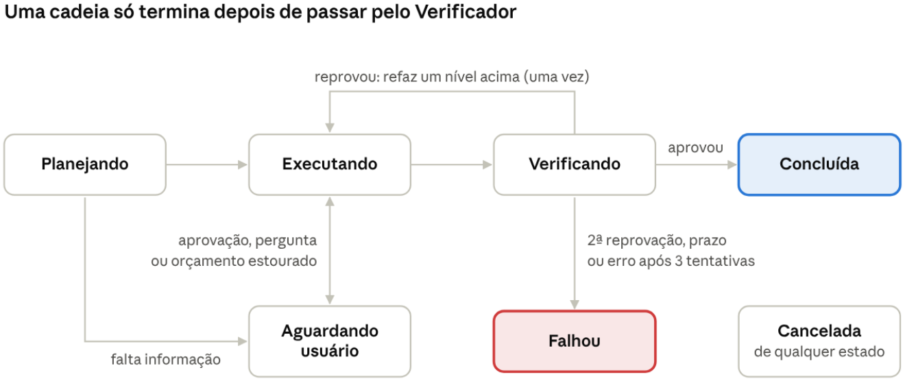

# Especificação do backend (fase 1)

**Versão 2** (revisada para combinar com o app em `app/`; o que mudou está no [README](README.md)).

Esta aba define o que falta para escrever o código da fase 1: banco, API, **contrato com o app**, ferramentas, modelos, execução das cadeias, o Laya, busca, contas, deploy, organização do repositório e testes. Os prompts estão na aba Prompts.

## 1. Modelo de dados

São 22 tabelas no PostgreSQL. Toda tabela com dados de usuário tem `usuario_id`, e toda consulta filtra por ele: é isso que separa os dados de um usuário dos outros.

| Tabela | O que guarda | Fase |
| --- | --- | --- |
| `usuarios` | Conta, idioma e plano | 1 |
| `agentes` | A Sora, os agentes individuais e os especialistas de cada cadeia, com papel, aparência (cor e movimento), nível de modelo e ferramentas permitidas | 1 |
| `conversas` | Um chat: com a Sora (`chat`), um projeto (`projeto`, a pasta em CHATS) ou um agente individual (`agente`) | 1 |
| `passos` | O que cada especialista fez numa etapa (ferramenta, parâmetros, resultado), para o painel Trabalho | 1 |
| `entregas` | O resultado de cada especialista, com versão, para a Revisão | 1 |
| `anexos` | Arquivos enviados pelo usuário | 1 |
| `mensagens` | Tudo que foi dito. `visivel = false` marca raciocínio interno e lembretes | 1 |
| `roteamentos` | A saída do Sistema 1 para cada pedido, usada na linha do tempo e nos testes | 1 |
| `cadeias` | Um pedido em modo cadeia: plano, estado, orçamento e custo | 1 |
| `etapas` | Cada passo da cadeia: especialista, modelo, entrada, saída, tentativas e custo | 1 |
| `chamadas_modelo` | Cada chamada a um modelo, com tokens, custo e latência | 1 |
| `perguntas` | Cartões de pergunta e a resposta do usuário | 1 |
| `aprovacoes` | Cartões de aprovação, a avaliação do revisor e a decisão | 1 |
| `regras_permissao` | As escolhas "sempre permitir" do usuário | 1 |
| `registro_acoes` | Todo efeito externo, com agente, motivo e aprovação | 1 |
| `sessoes`, `convites` e `tokens_email` | Sessões de login, convites de cadastro e tokens de e-mail (seção 8.2) | 1 (tokens de e-mail: 2) |
| `evidencias` e `memorias` | Fila da memória e as memórias salvas | 2 |
| `provedores` | Cada API que o usuário conectou, com a chave cifrada, o teto de gasto e as falhas recentes | 1 |
| `modelos_disponiveis` | Os modelos de cada provedor, com nível, capacidades, contexto e preço | 1 |

O SQL da fase 1 e da memória:

```sql
create extension if not exists pgcrypto;

create type tipo_agente as enum ('sora', 'individual', 'especialista');
create type tipo_conversa as enum ('chat', 'projeto', 'agente');
create type movimento as enum ('gira', 'vibracao', 'espiral', 'ondas');   -- os mesmos do app (src/types.ts)
create type autor_msg as enum ('usuario', 'sora', 'agente', 'sistema');
create type status_cadeia as enum ('planejando', 'executando', 'verificando', 'aguardando_usuario', 'concluida', 'falhou', 'cancelada');
create type status_etapa as enum ('pendente', 'executando', 'aguardando_usuario', 'aguardando_aprovacao', 'concluida', 'reprovada', 'falhou', 'cancelada');
create type status_aprovacao as enum ('pendente', 'permitida', 'negada', 'expirada');
create type tipo_memoria as enum ('perfil', 'log');
create type origem_memoria as enum ('explicita', 'sintese');

create table usuarios (
  id uuid primary key default gen_random_uuid(),
  email text unique not null,
  nome text not null,
  idioma text not null default 'pt-BR',
  plano text not null default 'gratis',
  criado_em timestamptz not null default now()
);

create table agentes (
  id uuid primary key default gen_random_uuid(),
  usuario_id uuid not null references usuarios(id),
  tipo tipo_agente not null,
  nome text not null,
  funcao text not null default '',         -- rótulo curto mostrado no app ("Pesquisa e referências")
  papel text not null default '',          -- descrição que entra no prompt (instruções)
  cor text not null default '#E2ECFF',     -- hex; só a Sora usa #E2ECFF, os outros recebem uma cor livre da paleta
  movimento movimento not null default 'gira',
  nivel_padrao text not null default 'N2', -- N1, N2 ou N3
  modelo_padrao text,                      -- opcional: o usuário fixou um modelo para este agente
  ferramentas text[] not null default '{}',
  cadeia_id uuid,                          -- só especialistas: a cadeia em que nasceram (FK adicionada depois de cadeias)
  criado_em timestamptz not null default now(),
  apagado_em timestamptz                   -- só o usuário apaga
);
-- limite de 5 agentes individuais ativos (tipo = 'individual'): checado na API antes do insert.
-- especialistas não contam no limite; "Salvar como agente" troca o tipo para 'individual' (aí conta).

create table conversas (
  id uuid primary key default gen_random_uuid(),
  usuario_id uuid not null references usuarios(id),
  agente_id uuid not null references agentes(id),   -- a Sora (chat/projeto) ou o agente individual
  tipo tipo_conversa not null default 'chat',       -- vira 'projeto' quando a primeira cadeia nasce
  titulo text,
  aprovada_versao int,                              -- projeto: última versão aprovada na Revisão
  criada_em timestamptz not null default now(),
  atualizada_em timestamptz not null default now()
);

create table mensagens (
  id uuid primary key default gen_random_uuid(),
  conversa_id uuid not null references conversas(id),
  autor autor_msg not null,
  agente_id uuid references agentes(id),
  conteudo text not null,
  anexos jsonb not null default '[]',
  visivel boolean not null default true,
  responde_a uuid references mensagens(id),
  criada_em timestamptz not null default now()
);
create index on mensagens (conversa_id, criada_em);

create table roteamentos (
  id uuid primary key default gen_random_uuid(),
  mensagem_id uuid not null references mensagens(id),
  saida jsonb not null,          -- JSON completo do Sistema 1
  modelo text not null,
  confianca real not null,
  escalou boolean not null default false,
  latencia_ms int not null,
  criado_em timestamptz not null default now()
);

create table cadeias (
  id uuid primary key default gen_random_uuid(),
  usuario_id uuid not null references usuarios(id),
  conversa_id uuid not null references conversas(id),
  pedido_id uuid not null references mensagens(id),
  status status_cadeia not null default 'planejando',
  plano jsonb,
  versao int not null default 1,          -- 1 na cadeia original; cada "Pedir ajuste" cria a próxima
  rodada int not null default 0,
  passos int not null default 0,
  orcamento_tokens int not null,
  tokens_usados int not null default 0,
  custo_usd numeric(10,4) not null default 0,
  criada_em timestamptz not null default now(),
  concluida_em timestamptz
);

create table etapas (
  id uuid primary key default gen_random_uuid(),
  cadeia_id uuid not null references cadeias(id),
  ordem int not null,
  depende_de int[] not null default '{}',
  especialista text not null,             -- papel: pesquisador, redator, designer, verificador
  agente_id uuid references agentes(id),  -- o especialista com nome/cor que aparece no app
  titulo text not null default '',        -- título curto da tarefa no app ("Pesquisar referências")
  nivel text not null,
  modelo text,
  tarefa text not null,
  saida jsonb,
  status status_etapa not null default 'pendente',
  tentativa int not null default 1,
  tokens int not null default 0,
  custo_usd numeric(10,4) not null default 0,
  erro text,
  iniciada_em timestamptz,
  concluida_em timestamptz,
  unique (cadeia_id, ordem, tentativa)
);
alter table agentes add constraint agentes_cadeia_fk foreign key (cadeia_id) references cadeias(id);

-- painel Trabalho: um passo por pensamento curto, chamada de ferramenta, repasse ou entrega
create type tipo_passo as enum ('prompt', 'pensamento', 'ferramenta', 'entrega', 'handoff');
create table passos (
  id uuid primary key default gen_random_uuid(),
  etapa_id uuid not null references etapas(id),
  agente_id uuid not null references agentes(id),
  tipo tipo_passo not null,
  texto text not null,                    -- rótulo legível: "Buscando: cafeterias no bairro"
  ferramenta text,                        -- nome mostrado ("Busca na web")
  acao text,                              -- nome técnico ("buscar_web")
  parametros jsonb,                       -- já sem segredos
  resultado jsonb,                        -- {resumo, links[{titulo, dominio}], itens[]}
  para_agente_id uuid references agentes(id),   -- handoff
  status text not null default 'executando',    -- executando | concluido | erro
  iniciado_em timestamptz not null default now(),
  concluido_em timestamptz
);
create index on passos (etapa_id, iniciado_em);

-- Revisão: o que cada especialista entregou, por versão
create type tipo_entrega as enum ('texto', 'links', 'imagem', 'calendario', 'arquivo');
create table entregas (
  id uuid primary key default gen_random_uuid(),
  usuario_id uuid not null references usuarios(id),
  conversa_id uuid not null references conversas(id),
  cadeia_id uuid not null references cadeias(id),
  etapa_id uuid references etapas(id),
  agente_id uuid references agentes(id),
  versao int not null,
  tipo tipo_entrega not null,
  titulo text not null,                   -- "Pesquisa"
  resumo text not null,                   -- "4 referências"
  conteudo jsonb not null,                -- itens, links, imagens (ids de anexos), linhas do calendário
  criada_em timestamptz not null default now()
);
create index on entregas (conversa_id, versao);

create table anexos (
  id uuid primary key default gen_random_uuid(),
  usuario_id uuid not null references usuarios(id),
  nome text not null,
  tipo text not null,                     -- MIME
  tamanho int not null,                   -- bytes; até 20 MB (o mesmo limite do app)
  caminho text not null,                  -- no volume de arquivos do servidor
  origem text not null default 'usuario', -- usuario | especialista (imagens geradas, arquivos do Redator)
  criado_em timestamptz not null default now()
);

create table chamadas_modelo (
  id uuid primary key default gen_random_uuid(),
  usuario_id uuid not null references usuarios(id),
  cadeia_id uuid references cadeias(id),
  etapa_id uuid references etapas(id),
  papel text not null,   -- sistema1, sora, planejador, especialista, verificador, revisor, memoria
  modelo text not null,
  nivel text not null,
  tokens_entrada int not null,
  tokens_saida int not null,
  custo_usd numeric(10,6) not null,
  latencia_ms int not null,
  criado_em timestamptz not null default now()
);

create table perguntas (
  id uuid primary key default gen_random_uuid(),
  conversa_id uuid not null references conversas(id),
  cadeia_id uuid references cadeias(id),
  texto text not null,
  opcoes jsonb not null,        -- [{"rotulo": "...", "valor": "..."}]
  resposta_livre boolean not null default false,
  resposta text,
  respondida_em timestamptz
);

create table aprovacoes (
  id uuid primary key default gen_random_uuid(),
  usuario_id uuid not null references usuarios(id),
  etapa_id uuid references etapas(id),
  agente_id uuid not null references agentes(id),
  acao jsonb not null,          -- {"ferramenta": "...", "argumentos": {...}}
  avaliacao jsonb not null,     -- saída do revisor de ações
  status status_aprovacao not null default 'pendente',
  expira_em timestamptz not null,
  decidida_em timestamptz
);

create table regras_permissao (
  id uuid primary key default gen_random_uuid(),
  usuario_id uuid not null references usuarios(id),
  agente_id uuid references agentes(id),   -- null = vale para todos
  ferramenta text not null,
  condicao jsonb not null default '{}',    -- ex.: {"destino": "meu-email@..."}
  criada_em timestamptz not null default now()
);

create table registro_acoes (
  id uuid primary key default gen_random_uuid(),
  usuario_id uuid not null references usuarios(id),
  agente_id uuid not null references agentes(id),
  etapa_id uuid references etapas(id),
  ferramenta text not null,
  resumo text not null,
  aprovacao_id uuid references aprovacoes(id),
  criado_em timestamptz not null default now()
);

-- fase 2: memória
create table evidencias (
  id uuid primary key default gen_random_uuid(),
  usuario_id uuid not null references usuarios(id),
  agente_id uuid references agentes(id),
  pergunta text not null,       -- até 8.000 caracteres
  resposta text not null,       -- até 8.000 caracteres
  ocorreu_em timestamptz not null,
  processada boolean not null default false
);

create table memorias (
  id uuid primary key default gen_random_uuid(),
  usuario_id uuid not null references usuarios(id),
  agente_id uuid references agentes(id),  -- null = memória do usuário
  tipo tipo_memoria not null,
  conteudo varchar(500) not null,
  origem origem_memoria not null,
  travada boolean not null default false, -- true quando origem = explicita
  evidencias uuid[] not null default '{}',
  data_referencia date,
  embedding vector(768),                  -- pgvector (create extension vector), para a busca semântica
  criada_em timestamptz not null default now(),
  atualizada_em timestamptz not null default now(),
  apagada_em timestamptz
);
```

O SQL das APIs do usuário (seção 5):

```sql
create type tipo_provedor as enum ('groq', 'openai', 'anthropic', 'google', 'openrouter', 'compativel_openai', 'ollama');
create type prioridade as enum ('custo', 'velocidade', 'qualidade');

alter table usuarios add column prioridade prioridade not null default 'custo';
alter table conversas add column privada boolean not null default false;  -- privada = só modelos locais

create table provedores (
  id uuid primary key default gen_random_uuid(),
  usuario_id uuid not null references usuarios(id),
  tipo tipo_provedor not null,
  base_url text,                 -- obrigatória para compativel_openai e ollama
  chave_cifrada bytea,           -- AES-GCM; null no ollama local sem chave
  chave_final text,              -- 4 últimos caracteres, só para mostrar
  teto_mensal_usd numeric(10,2),
  falhas_seguidas int not null default 0,
  pausado_ate timestamptz,
  validado_em timestamptz,
  criado_em timestamptz not null default now(),
  apagado_em timestamptz
);

create table modelos_disponiveis (
  id uuid primary key default gen_random_uuid(),
  provedor_id uuid not null references provedores(id),
  modelo text not null,                       -- nome no LiteLLM, ex.: groq/openai/gpt-oss-20b
  nivel text not null,                        -- N1, N2, N3 ou especial
  capacidades text[] not null default '{}',   -- ferramentas, json, visao, imagem (gera imagens)
  contexto int not null,
  preco_entrada numeric(10,6),                -- US$ por 1M tokens
  preco_saida numeric(10,6),
  velocidade_tps int,
  origem text not null default 'catalogo',    -- catalogo ou usuario
  ativo boolean not null default true,
  unique (provedor_id, modelo)
);

alter table chamadas_modelo add column provedor_id uuid references provedores(id);
```

## 2. API

O app manda pedidos por HTTP e recebe tudo que a Sora faz por um canal SSE por conversa. Todas as rotas usam o prefixo `/v1` e o cabeçalho `Authorization: Bearer <token>`.

| Método e rota | Corpo | Resposta | Fase |
| --- | --- | --- | --- |
| `POST /v1/auth/entrar` | `{email, senha}` | `{token_acesso}` (as rotas de conta estão na seção 8.2) | 1 |
| `GET /v1/agentes` | `?tipo=` | lista de agentes, com aparência (cor, movimento, função) | 1 |
| `POST /v1/agentes` | `{nome, funcao, papel, cor?, movimento?, ferramentas?}` ou `{descricao}` | agente individual criado (com `descricao`, o backend monta o perfil); 409 se já houver 5 | 1 |
| `POST /v1/agentes/{id}/promover` |  | "Salvar como agente": especialista vira individual; 409 se já houver 5 | 1 |
| `PATCH /v1/agentes/{id}` | `{nome?, funcao?, papel?, cor?, movimento?, modelo_padrao?}` | agente | 1 |
| `DELETE /v1/agentes/{id}` |  | 204 | 1 |
| `GET /v1/conversas` |  | lista de conversas (chat, projeto e agente), com resumo de estado para a barra lateral | 1 |
| `POST /v1/conversas` | `{agente_id?, texto, anexos?}` | conversa criada já com a primeira mensagem (é o "Novo chat"); sem `agente_id` = com a Sora | 1 |
| `PATCH /v1/conversas/{id}` | `{titulo}` | conversa (Renomear) | 1 |
| `DELETE /v1/conversas/{id}` | `?manter_agentes=` | 204 (Apagar; com `manter_agentes`, os especialistas viram individuais se houver vaga) | 1 |
| `GET /v1/conversas/{id}/mensagens` | `?antes=&limite=` | mensagens visíveis | 1 |
| `POST /v1/conversas/{id}/mensagens` | `{texto, anexos?, para_agente_id?}` | 202 `{mensagem_id}` (com `para_agente_id` = mensagem a um especialista, que a Sora repassa) | 1 |
| `GET /v1/conversas/{id}/eventos` | cabeçalho `Last-Event-ID` opcional | fluxo SSE da conversa | 1 |
| `GET /v1/eventos` | cabeçalho `Last-Event-ID` opcional | fluxo SSE do usuário: só eventos de estado (cadeias, etapas, passos, agentes), de todas as conversas. Alimenta a Ilha e a barra lateral | 1 |
| `GET /v1/cadeias/{id}` |  | plano, etapas, passos, modelos e custos (linha do tempo) | 1 |
| `POST /v1/cadeias/{id}/cancelar` |  | 202 | 1 |
| `GET /v1/conversas/{id}/entregas` | `?versao=` | entregas da versão (padrão: a mais nova) e a lista de versões | 1 |
| `POST /v1/conversas/{id}/aprovar` | `{versao}` | 204 (Revisão → Aprovar) | 1 |
| `POST /v1/conversas/{id}/ajuste` | `{texto, agente_id?}` | 202 (Pedir ajuste: nova cadeia com `versao + 1`, só com o especialista certo) | 1 |
| `POST /v1/anexos` | multipart, até 20 MB por arquivo | `{anexo_id, nome, tipo, tamanho}` | 1 |
| `GET /v1/anexos/{id}` |  | o arquivo (só do próprio usuário) | 1 |
| `POST /v1/perguntas/{id}/responder` | `{valor}` | 204 | 1 |
| `POST /v1/aprovacoes/{id}/decidir` | `{decisao: permitir_uma_vez \| sempre_permitir \| negar}` | 204 | 1 |
| `GET /v1/uso` | `?de=&ate=` | tokens e custo por dia e por papel | 1 |
| `GET, POST, PATCH, DELETE /v1/memorias` | `{conteudo}` | memórias do usuário | 2 |
| `POST /v1/provedores` | `{tipo, chave, base_url?}` | provedor e os modelos encontrados, ou 422 se a chave falhar no teste | 1 |
| `GET /v1/provedores` |  | provedores, com os 4 últimos caracteres da chave e o gasto do mês | 1 |
| `PATCH /v1/provedores/{id}` | `{chave?, teto_mensal_usd?}` | provedor | 1 |
| `DELETE /v1/provedores/{id}` |  | 204 | 1 |
| `GET /v1/modelos` |  | modelos disponíveis, com nível, capacidades e preço | 1 |
| `PATCH /v1/modelos/{id}` | `{nivel?, ativo?}` | modelo | 1 |
| `PATCH /v1/preferencias` | `{prioridade: custo \| velocidade \| qualidade}` | 204 | 1 |

Eventos do canal SSE. Cada evento tem como `id` o id do Redis Stream (texto, por exemplo `1697040000000-0`; o app trata como texto opaco), e o app reconecta com `Last-Event-ID` para receber o que perdeu:

| Evento | Quando | Campos |
| --- | --- | --- |
| `mensagem.inicio` | A Sora começa uma mensagem | `mensagem_id, autor, agente_id` |
| `mensagem.delta` | Cada pedaço do texto | `mensagem_id, texto` |
| `mensagem.fim` | A mensagem termina | `mensagem_id, anexos` |
| `roteamento` | O Sistema 1 decide | `modo, dificuldade, especialistas, nivel`, provedor, modelo |
| `conversa.atualizada` | Título, tipo (virou `projeto`) ou aprovação mudaram | `conversa_id, titulo, tipo, aprovada_versao` |
| `agente.criado` | Um especialista nasce na cadeia ou um agente individual é criado | `agente_id, tipo, nome, funcao, cor, movimento` |
| `cadeia.criada` | O planejador termina | `cadeia_id, versao, etapas: [{etapa_id, ordem, especialista, agente_id, titulo, nivel, depende_de}]` |
| `etapa.atualizada` | Uma etapa muda de estado | `etapa_id, status, progresso (0–100), modelo, tokens, custo_usd` |
| `passo` | Um especialista pensa, chama uma ferramenta, repassa ou entrega (painel Trabalho) | `passo_id, etapa_id, agente_id, tipo, texto, ferramenta, acao, parametros, resultado, status, para_agente_id` |
| `entrega` | Um especialista entregou | `entrega_id, agente_id, versao, tipo, titulo, resumo` |
| `cadeia.atualizada` | A cadeia muda de estado | `cadeia_id, status, tokens_usados, custo_usd` (`concluida` = projeto pronto para revisar) |
| `pergunta` | A Sora precisa de uma decisão | `pergunta_id, texto, opcoes, resposta_livre` |
| `aprovacao.pedida` | O revisor bloqueou uma ação | `aprovacao_id, resumo, dano, quem_recebe, expira_em` |
| `aprovacao.resolvida` | O usuário decidiu ou o prazo venceu | `aprovacao_id, status` |
| `sugestoes` | Ao fim de uma resposta | `itens: [texto]` |
| `erro` | Falha que o usuário precisa ver | `codigo, mensagem` |
| `ping` | A cada 15 segundos | (vazio) |

Como a API entrega os eventos: cada mudança é gravada num Redis Stream `eventos:{conversa_id}` com `XADD`, guardado por 24 horas. Os eventos de estado (`conversa.atualizada`, `agente.criado`, `cadeia.*`, `etapa.atualizada`, `passo`, `entrega`, `aprovacao.*`; o texto das mensagens não) também vão para `eventos:usuario:{usuario_id}`, que é o canal da Ilha e da barra lateral. Nesse canal, todo evento leva também `conversa_id`, para o app saber a que conversa ele pertence. A rota SSE lê o stream com `XREAD` a partir do `Last-Event-ID`. Ao abrir o app, ele primeiro busca o estado completo (`GET /v1/conversas`, `GET /v1/cadeias/{id}`) e depois só aplica eventos.

O que acontece num `POST /mensagens`:

1. A API grava a mensagem e chama o Sistema 1 ali mesmo, sem passar pela fila, porque ele é rápido.
2. O Sistema 1 já devolve a primeira resposta curta, que vai para o canal SSE.
3. Se o modo for `direto`, a resposta completa sai em streaming pelo modelo N1 ou N2, num job curto (a requisição já devolveu 202).
4. Se o modo for `cadeia`, a API cria a cadeia, marca a conversa como `projeto` e põe o job `planejar_cadeia` na fila. A partir daí tudo chega pelo SSE.
5. Numa conversa com agente individual, o Sistema 1 só decide direto ou cadeia; quem fala é o agente.
6. Com `para_agente_id` (mensagem a um especialista), a mensagem vira `mensagem_especialista` na etapa em andamento e a Sora confirma em uma frase.

O **Agente independente** do Novo chat é `POST /v1/agentes {descricao}` seguido de `POST /v1/conversas {agente_id, texto}`: o modo não passa pelo Sistema 1, porque o usuário já escolheu.

Exemplo de evento:

```json
id: 1697040000000-0
event: etapa.atualizada
data: {"etapa_id": "7c1e...", "status": "concluida", "progresso": 100, "modelo": "groq/openai/gpt-oss-120b", "tokens": 3812, "custo_usd": 0.0021}
```

## 3. Contrato com o app

O app (`app/`) já existe e hoje simula tudo com um relógio em `app/src/state/projetos.ts`. Esta seção diz como ele passa a usar o backend sem refazer as telas.

### 3.1 Um modo só: o real

- O estado vem da API e dos eventos SSE. As telas só conhecem eventos.
- **Sem modo demonstração** (decisão de 2026-10-14). A simulação por relógio (`state/projetos.ts`) e os dados de exemplo saem do app quando a camada `src/api/` entrar.
- Para desenvolver sem gastar com modelos, o backend roda com o **modelo falso** (`SORA_MODELO_FALSO=1`, seção 8.5), que responde rápido e de graça seguindo o mesmo fluxo de eventos.

Peças novas no app:

| Arquivo | O que faz |
| --- | --- |
| `src/api/cliente.ts` | `fetch` com o token de acesso, renovação automática no 401 e erros padronizados |
| `src/api/eventos.ts` | SSE com `@microsoft/fetch-event-source` (manda o `Authorization`), reconexão com `Last-Event-ID` |
| `src/state/aplicarEvento.ts` | Redutor: `(estado, evento) → estado`. É o único lugar que entende os eventos da seção 2 |

### 3.2 Nomes dos dois lados

| No app (hoje) | No backend | Observação |
| --- | --- | --- |
| `ProjetoSora` (`tipo: 'chat' \| 'projeto'`) | `conversas` (`tipo: chat \| projeto \| agente`) | Pasta em CHATS = conversa `projeto` |
| `MensagemChat.conversaId = 'sora:<id>'` ou `<agenteId>` | `mensagens.conversa_id` | O app passa a usar o id da conversa direto |
| `AgenteSora` (`nome, funcao, cor, tipoMovimento, ferramentas, instrucoes, avulso`) | `agentes` (`nome, funcao, cor, movimento, ferramentas, papel, tipo`) | `avulso = true` ↔ `tipo = 'individual'`; `instrucoes` ↔ `papel` |
| `TarefaGerada` / plano | `etapas` / `cadeias.plano` | Título da tarefa = `etapas.titulo` |
| `Execucao` + roteiro com `em`/`dur` | `etapas` + `passos` | O tempo deixa de ser calculado: vem dos eventos |
| `PassoTrabalho` (`prompt, pensamento, ferramenta, entrega, handoff`) | `passos` (mesmos tipos) | Mesmos campos: `ferramenta, acao, parametros, resultado, paraAgenteId` |
| `EntregaGerada` / `entregas` + `entregasAnteriores` | `entregas` por versão | A comparação usa `versao` e `versao - 1` |
| `aprovadoEm` | `conversas.aprovada_versao` | |
| `Status` do agente (`aguardando, trabalhando, concluido, erro`) | derivado de `etapas.status` | `executando` → trabalhando; `concluida` → concluido; `falhou` → erro |
| `state/modelos.ts` (chaves no `localStorage`) | `provedores` + `modelos_disponiveis` | A chave sai do navegador |
| créditos (`state/creditos.ts`) | `GET /v1/uso` | Vira "Uso do mês" (US$ por provedor). Créditos saem do app |

### 3.3 O que muda nas telas

- **Onboarding:** Entrar / Criar conta → "Conecte sua primeira API" . Sem provedor validado, pedidos reais recebem 412 e o app leva para essa tela.
- **Novo chat:** o seletor **Equipe | Agente independente** continua. Equipe → `POST /v1/conversas`. Agente independente → `POST /v1/agentes {descricao}` e depois a conversa com ele.
- **Barra lateral:** a pasta do projeto lista os agentes de `agente.criado`; o resumo ("3 agentes · 1 trabalhando") vem de `etapa.atualizada`.
- **Chat do projeto:** cartões de pergunta (`pergunta`), chip do roteamento (`roteamento`), botão Cancelar (enquanto a cadeia roda), sugestões ao fim.
- **Página de um especialista** (`/chat/:id`): mostra o painel Trabalho dele; o campo de mensagem manda `para_agente_id` (correção de rota; quem responde é a Sora). Botão "Salvar como agente".
- **Painel Trabalho:** passa a ler `passos`. Os nomes de ferramentas simulados (Figma, Canva, Instagram, Notion) saem do app até a fase 3: aparecem só as ferramentas de verdade (Busca na web, Ler página, Escrever arquivo, Gerar imagem).
- **Revisão:** lê `GET /v1/conversas/{id}/entregas`. O botão "Aprovar e publicar" vira **Aprovar** até existirem conectores (fase 3).
- **Ilha da Sora:** lê o canal `GET /v1/eventos`. Nada muda na aparência.
- **Configurações → Modelos de IA:** `GET/POST/PATCH/DELETE /v1/provedores`, `GET/PATCH /v1/modelos`, prioridade (`PATCH /v1/preferencias`) e teto de gasto. A tela mostra só os 4 últimos caracteres da chave.
- **Agentes:** limite "3 de 5" na galeria e no construtor; o construtor salva com `POST/PATCH /v1/agentes`.
- **Rodapé da conta:** nome do usuário real (hoje é o mock "Cafeteria Aroma · Plano Pro"). "Compartilhar" só faz sentido quando houver link público (fora da fase 1: o botão fica escondido no modo real).

### 3.4 App de desktop (Tauri)

- O desktop é o mesmo app com a mesma API. A janela da ilha usa o canal `GET /v1/eventos`.
- **Login:** o cookie de renovação não funciona no desktop (o app roda em `http://tauri.localhost`, outro site para o navegador). Lá, o token de renovação vem no corpo da resposta e fica no **cofre do sistema** (Credential Manager no Windows, via plugin de keyring do Tauri); a renovação manda o token no corpo. Detalhes na seção 8.2.
- **CORS:** liberar `http://tauri.localhost` e `tauri://localhost` além do domínio do app web.
- **CSP do desktop** (`app/src-tauri/tauri.conf.json`): acrescentar o domínio da API em `connect-src`.

## 4. Ferramentas

Cada ferramenta é uma classe Pydantic, entregue ao agente como ferramenta do LangChain (`@tool` com `args_schema` = a classe; veja 6.1). O backend só entrega a um agente as ferramentas listadas em `agentes.ferramentas` ou no papel do especialista, e o revisor de ações roda antes de toda ferramenta marcada com "sim".

| Ferramenta | Parâmetros | Quem usa | Revisor | Fase |
| --- | --- | --- | --- | --- |
| `falar` | `texto, anexos?, responde_a?` | Sora e agentes individuais | não | 1 |
| `perguntar` | `texto, opcoes[{rotulo, valor}], resposta_livre` | Sora e agentes individuais | não | 1 |
| `disparar_especialista` | `papel, tarefa, nivel?` | Sora | não | 1 |
| `ver_especialista` | `etapa_id` | Sora | não | 1 |
| `mensagem_especialista` | `etapa_id, texto` | Sora | não | 1 |
| `parar_especialista` | `etapa_id` | Sora | não | 1 |
| `buscar_web` | `consulta, max_resultados = 5` | Pesquisador | não | 1 |
| `ler_pagina` | `url` | Pesquisador | não | 1 |
| `ler_anexo` | `anexo_id` | todos | não | 1 |
| `escrever_arquivo` | `nome, conteudo` (só na pasta da cadeia; vira anexo) | Redator | não | 1 |
| `gerar_imagem` | `descricao, proporcao = "1:1" \| "4:5" \| "9:16" \| "16:9", quantidade = 1..4` | Designer | não | 1 (só se o usuário conectou um modelo com a capacidade `imagem`) |
| `entregar` | `tipo, titulo, resumo, conteudo, fontes[], pendencias[]` (vira uma linha em `entregas`) | especialistas | não | 1 |
| `veredito` | `aprovado, requisitos[{requisito, evidencia, status}], motivo` | Verificador | não | 1 |
| `criar_agente` | `nome, papel` | Sora | sempre pede aprovação por cartão fixo (sem modelo revisor) | 1 |
| `buscar_memoria` | `consulta` | todos | não | 2 |
| `lembrar` | `conteudo` (só quando o usuário pede) | Sora e agentes individuais | não | 2 |
| `enviar_para_agente` | `agente_id, texto, prioridade = false` | Sora e agentes individuais | não | 2 |
| `chamar_conector` | `servidor, ferramenta, argumentos` | conforme o papel | sim | 3 |
| `executar_comando` | `comando` (no computador da nuvem) | Executor | sim | 3 |
| `navegador_*` | navegar, clicar, digitar, snapshot, print | subagente de navegador | sim, nas ações que enviam algo | 3 |

Regras de todas as ferramentas:

- Resultado com mais de 20.000 caracteres vai para um arquivo, e o modelo recebe o caminho e as primeiras linhas.
- Todo resultado de `buscar_web`, `ler_pagina`, `ler_anexo` e `chamar_conector` vai dentro da cerca de dado não confiável (aba Prompts).
- Argumentos inválidos passam por uma tentativa de conserto e nova validação. Se falhar de novo, o modelo recebe o erro de validação.
- Prazo padrão de 2 minutos por chamada de ferramenta e de 5 minutos por etapa na fase 1.
- Toda chamada de ferramenta de um especialista gera um evento `passo` (seção 2): o backend monta o rótulo a partir do nome e dos argumentos ("Buscando: cafeterias no bairro", "Lendo: g1.globo.com", "Gerando 3 imagens"), sem segredos, e atualiza o mesmo passo com o resultado resumido. O modelo não precisa narrar nada para o painel Trabalho funcionar.
- `gerar_imagem` usa a API de imagem do provedor do usuário pelo LiteLLM (`image_generation`), com a chave dele. As imagens viram anexos (`origem = especialista`). Sem modelo de imagem conectado, o planejador não usa o Designer e o Redator entrega as peças como texto (descrição e legenda de cada peça).

Exemplo de definição:

```python
from pydantic import BaseModel, Field

class Opcao(BaseModel):
    rotulo: str = Field(max_length=40)
    valor: str = Field(description="O que volta para a Sora, escrito como o usuário responderia")

class Perguntar(BaseModel):
    """Pergunta ao usuário com opções clicáveis. Use só para ação irreversível ou ambiguidade real."""
    texto: str = Field(max_length=200)
    opcoes: list[Opcao] = Field(min_length=2, max_length=4)
    resposta_livre: bool = False

FERRAMENTAS_POR_PAPEL = {
    "sora": ["falar", "perguntar", "disparar_especialista", "ver_especialista",
             "mensagem_especialista", "parar_especialista", "ler_anexo"],
    "pesquisador": ["buscar_web", "ler_pagina", "ler_anexo", "entregar"],
    "redator": ["ler_anexo", "escrever_arquivo", "entregar"],
    "designer": ["ler_anexo", "gerar_imagem", "entregar"],
    "verificador": ["buscar_web", "ler_pagina", "ler_anexo", "veredito"],
    "individual": ["falar", "perguntar", "ler_anexo", "buscar_web", "ler_pagina", "escrever_arquivo"],
}

# aparência dos especialistas no app (escolhida por código, nunca pelo modelo)
APARENCIA_POR_PAPEL = {
    "pesquisador": {"funcao": "Pesquisa e referências", "movimento": "vibracao"},
    "redator":     {"funcao": "Textos e planejamento", "movimento": "ondas"},
    "designer":    {"funcao": "Criação visual",        "movimento": "espiral"},
    "verificador": {"funcao": "Verificação",           "movimento": "gira"},
}
# nome: o primeiro livre da lista de nomes do app (app/src/data/planejador.ts, NOMES_AGENTES)
# cor: a primeira livre da paleta do app (PALETA_AGENTES), nunca #E2ECFF (é da Sora)
```

## 5. Modelos: APIs do usuário, catálogo e seletor

A Sora não tem modelo fixo. O usuário conecta as APIs que quiser, e a cada chamada um seletor escolhe o melhor modelo entre os que ele conectou, de acordo com o papel e a dificuldade decidida pelo Sistema 1.

### Como o usuário conecta uma API

1. Escolhe o provedor e cola a chave: Groq, OpenAI, Anthropic, Google, OpenRouter, qualquer API compatível com a da OpenAI (informando a URL) ou o Ollama local.
2. O backend testa a chave listando os modelos do provedor. Se o teste falhar, mostra o erro e não salva nada.
3. A chave é cifrada com AES-GCM. A chave-mestra fica fora do banco, num cofre ou variável de ambiente. A chave do usuário nunca volta para o app: a tela mostra só os 4 últimos caracteres, e ela nunca aparece em log.
4. Cada modelo listado é cruzado com o catálogo e ganha nível, capacidades e preço.
5. O usuário pode desligar modelos, mudar o nível de um modelo e definir um teto de gasto mensal por provedor.

Na chamada, o LiteLLM recebe a chave e a URL do provedor do próprio usuário (`api_key` e `api_base` por chamada). O usuário paga cada provedor direto, e a Sora mostra quanto ele gastou em cada um.

### Catálogo de modelos

O arquivo `catalogo_modelos.yaml` é mantido pela equipe e diz o nível, as capacidades, o contexto, o preço e a velocidade de cada modelo conhecido. Preço e contexto podem vir do mapa de custos do LiteLLM (`litellm.model_cost`). O nível é definido pela equipe com o teste no fim desta seção. Um modelo fora do catálogo entra como N2 e sem capacidades confirmadas, até ser testado ou classificado pelo usuário.

Catálogo inicial com os modelos mais usados de cada provedor, conferido em Oct 11, 2026. O nível é uma proposta até o modelo passar no teste do fim desta seção. Preços em dólar por 1 milhão de tokens (entrada / saída), na faixa padrão de contexto. Eles mudam com frequência, então o catálogo deve ser revisto todo mês.

| Provedor | Modelo (nome no LiteLLM) | Nível proposto | Uso na Sora | Preço (entrada / saída) |
| --- | --- | --- | --- | --- |
| Groq | `groq/openai/gpt-oss-20b` | N1 | Sistema 1, memória, resumos | 0,075 / 0,30 |
| Groq | `groq/llama-3.1-8b-instant` | N1 | Sistema 1 reserva | sob consulta |
| Groq | `groq/openai/gpt-oss-120b` | N2 | Sora, especialistas, verificador | 0,15 / 0,60 |
| Groq | `groq/openai/gpt-oss-safeguard-20b` (prévia) | especial | Revisor de ações | 0,075 / 0,30 |
| Groq | `groq/meta-llama/llama-prompt-guard-2-86m` (prévia) | especial | Detectar injeção de prompt | 0,04 / 0,04 |
| OpenAI | `openai/gpt-5.6-luna` | N1 | Tarefas rápidas e baratas | 0,20 / 1,20 |
| OpenAI | `openai/gpt-5.6-terra` | N2 | Sora e especialistas | 2,00 / 12,00 |
| OpenAI | `openai/gpt-5.6-sol` | N3 | Planejador, código, raciocínio difícil | 5,00 / 30,00 |
| Anthropic | `anthropic/claude-haiku-5-5` | N1 | Tarefas rápidas e de alto volume | 0,10 / 0,50 (prompt até 100 mil tokens) |
| Anthropic | `anthropic/claude-sonnet-5-5` | N2 | Sora e especialistas | 2 / 10 |
| Anthropic | `anthropic/claude-opus-5-5` | N3 | Planejador e tarefas longas de agente | 4 / 20 |
| Anthropic | `anthropic/claude-fable-5-1` | N3 (só se o usuário escolher) | Raciocínio muito exigente; o mais caro da lista | 10 / 50 |
| Google | `gemini/gemini-3.1-flash-lite` | N1 | Tarefas rápidas e baratas | 0,25 / 1,50 |
| Google | `gemini/gemini-3.8-flash` | N2 | Sora e especialistas | 0,75 / 3,75 (sobe para 1,50 / 7,50 em janeiro de 2027) |
| Google | `gemini/gemini-3.1-pro-preview` (prévia) | N3 | Planejador | 2 / 12 |
| xAI | `xai/grok-4.7` | N3 | Planejador, código; contexto de 500 mil tokens | 2 / 6 |
| DeepSeek | `deepseek/deepseek-flash` (V4.1 Flash) | N1 | O mais usado no OpenRouter; contexto de 1 milhão | 0,15 / 0,60 fora do pico; o dobro no pico |
| DeepSeek | `deepseek/deepseek-v4-pro` | N3 | Planejador e raciocínio | 0,66 / 1,98 fora do pico; o dobro no pico |
| Z.ai | GLM-5.3-Flash (confirmar o nome na API) | N1 | Tarefas rápidas | 0,15 / 0,50 |
| Z.ai | GLM-4.7-Flash (confirmar o nome na API) | N1 | Opção gratuita | grátis |
| Z.ai | GLM-5.3 (confirmar o nome na API) | N2 | Sora e especialistas | 1,40 / 4,40 |
| Mistral | Mistral Large (confirmar o nome na API) | N2 | Sora e especialistas | 0,50 / 1,50 |
| Ollama (local) | `ollama/llama3.1:8b`, `ollama/qwen3:8b`, `ollama/gemma4:e4b` | N1 | Conversas privadas, sem custo de API | grátis (roda na máquina do usuário) |
| Ollama (local) | `ollama/qwen3:14b`, `ollama/gemma4:12b`, `ollama/deepseek-r1:14b` | N2 | Conversas privadas que pedem mais raciocínio | grátis (precisa de GPU melhor) |
| Ollama (local) | `ollama/nomic-embed-text`, `ollama/mxbai-embed-large` | embeddings | Vetores para a busca semântica (pgvector, fase 2) | grátis |
| OpenAI | modelo de imagem da OpenAI (confirmar o nome atual na API) | imagem | Designer: peças da campanha | por imagem |
| Google | modelo de imagem do Gemini (confirmar o nome atual na API) | imagem | Designer: peças da campanha | por imagem |

Quem conecta o **OpenRouter** acessa quase todos os modelos acima com uma chave só (nome no formato `openrouter/<provedor>/<modelo>`). Os mais usados lá na semana desta consulta foram DeepSeek V4.1 Flash, GLM 5.3 Flash, Xiaomi MiMo-V2.6-Flash, Tencent Hy4 (prévia), NVIDIA Nemotron 3 Ultra (versão gratuita) e Claude Opus 5.5. Modelos que aparecem só no OpenRouter entram como N2 até passarem no teste.

Fontes dos preços: [Groq](https://console.groq.com/docs/models), [OpenAI](https://openai.com/api/pricing/), [Anthropic](https://platform.claude.com/docs/en/about-claude/pricing), [Google](https://ai.google.dev/gemini-api/docs/pricing), [xAI](https://docs.x.ai/docs/models), [DeepSeek](https://api-docs.deepseek.com/quick_start/pricing), [Z.ai](https://docs.z.ai/guides/overview/pricing), [Mistral](https://mistral.ai/pricing), [Ollama](https://ollama.com/library) e [ranking do OpenRouter](https://openrouter.ai/rankings).

### Seletor de modelo

O seletor é código comum, não um modelo, e roda antes de toda chamada:

1. Converte o papel e a dificuldade do Sistema 1 num nível, usando `politica.yaml`.
2. Filtra os modelos conectados e ativos que têm as capacidades exigidas: ferramentas, JSON, visão (se houver imagem) e contexto maior que o prompt.
3. Tira da lista os provedores que passaram do teto de gasto ou que estão em pausa por erro.
4. Ordena pela prioridade do usuário: custo, velocidade ou qualidade.
5. Devolve uma lista ordenada. O primeiro modelo é usado e os outros ficam de reserva.

Regras do seletor:

- **Sem modelo no nível pedido:** sobe para o nível de cima. Se não houver, usa o mais forte disponível e marca isso na linha do tempo.
- **Sistema 1:** usa sempre o modelo N1 mais rápido que o usuário conectou.
- **Verificador e verificação de memória:** preferem outro provedor, senão outro modelo. Se o usuário só tiver um modelo, rodam nele e a linha do tempo avisa.
- **Conversa privada:** quando o usuário marca uma conversa como privada, só entram modelos locais (Ollama).
- **Falhas:** em limite de taxa (429), erro 5xx ou prazo estourado, o seletor passa para o próximo da lista. Um provedor com 3 falhas seguidas fica 5 minutos em pausa.
- **Nenhuma API conectada:** não dá para fazer pedidos reais. O cadastro termina na tela de conectar a primeira API, e a API recusa pedidos (erro 412) de quem não tem nenhum provedor validado.
- **Imagem:** o Designer só entra no plano se houver um modelo ativo com a capacidade `imagem`; o seletor escolhe entre eles pela prioridade do usuário.

Arquivo `politica.yaml`. Os valores de limite são iniciais e devem ser ajustados com os testes:

```yaml
papeis:
  sistema1: {nivel: N1, preferir: velocidade, capacidades: [json]}
  resposta_direta: {nivel: N1, subir_se_dificuldade: 2}
  sora: {nivel: N2, capacidades: [ferramentas]}
  planejador: {nivel: N3, capacidades: [json]}
  pesquisador: {nivel: N2, capacidades: [ferramentas]}
  redator: {nivel: N2}
  designer: {nivel: N2, capacidades: [ferramentas]}   # gerar_imagem usa o modelo de imagem escolhido à parte
  imagem: {capacidades: [imagem]}
  agente_individual: {nivel: N2, capacidades: [ferramentas]}
  verificador: {nivel: N2, capacidades: [ferramentas], diferente_do_executor: true}
  revisor: {nivel: N2, capacidades: [json], preferir_modelo: groq/openai/gpt-oss-safeguard-20b}
  memoria_sintese: {nivel: N1, capacidades: [json]}
  memoria_verificacao: {nivel: N1, capacidades: [json], diferente_de: memoria_sintese}

dificuldade_para_nivel: {1: N1, 2: N2, 3: N3}
prioridade_padrao: custo        # custo | velocidade | qualidade

limites:
  confianca_minima_s1: 0.7
  cadeia: {rodadas: 3, passos: 10, tokens: 200000}
  especialistas_por_cadeia: 5
  agentes_individuais_por_usuario: 5
  lembrete_apos_chamadas_sem_falar: 6
  falhas_para_pausar_provedor: 3
  pausa_provedor_minutos: 5
```

Esqueleto do seletor:

```python
def escolher_modelos(usuario, papel, dificuldade, precisa: set[str], tokens_prompt: int) -> list[Modelo]:
    regra = POLITICA.papeis[papel]
    nivel = POLITICA.dificuldade_para_nivel.get(dificuldade, regra.nivel) if papel == "resposta_direta" else regra.nivel
    exigidas = set(regra.capacidades) | precisa

    candidatos = [
        m for m in usuario.modelos_ativos()
        if exigidas <= set(m.capacidades)
        and m.contexto > tokens_prompt
        and not m.provedor.em_pausa()
        and not m.provedor.passou_do_teto()
        and (not usuario.conversa_privada or m.provedor.tipo == "ollama")
    ]
    for n in niveis_a_partir_de(nivel):      # N1 -> N2 -> N3
        do_nivel = [m for m in candidatos if m.nivel == n]
        if do_nivel:
            return ordenar(do_nivel, usuario.prioridade, regra.preferir)
    return ordenar(candidatos, "qualidade", None)  # nada no nível: o mais forte que existir
```

### Teste dos modelos

O teste tem dois usos: definir o nível de cada modelo antes de ele entrar no catálogo e checar o Sistema 1 a cada mudança de prompt.

1. Montar 100 pedidos de exemplo, escritos como usuários reais escreveriam, cada um com a resposta esperada (modo, dificuldade, especialistas, risco): 30 diretos, 30 de cadeia, 15 de agente individual, 15 com ação externa e 10 ambíguos ou com tentativa de injeção.
2. Rodar cada pedido 3 vezes em cada modelo, com temperatura 0.
3. Comparar com as metas propostas:

| Métrica | Meta proposta |
| --- | --- |
| JSON válido de primeira | 99% |
| Modo correto | 90% |
| Pedidos com ação externa marcados com risco | 100% (nenhum pode escapar) |
| Latência do Sistema 1 (p95) | menos de 1 segundo |
| Custo por 1.000 pedidos | registrar e comparar |

4. Um modelo que bate todas as metas pode ser N1. Para N2 e N3, o teste usa 20 tarefas de cadeia, avaliadas pelo Verificador e por uma pessoa da equipe.
5. Guardar os pedidos no repositório e rodar o teste automaticamente a cada mudança.

## 6. Execução das cadeias na fila

As cadeias rodam em workers ARQ (Redis), fora da requisição. O banco é a fonte da verdade: se um worker cair, outro retoma do último estado salvo.

Sobre o ARQ: a versão atual (0.28.0, abril de 2026) está em modo só manutenção, ou seja, recebe correções mas não recursos novos ([PyPI](https://pypi.org/project/arq)). Ele é estável e atende a fase 1, porque toda a lógica de estado fica no banco. Os jobs ficam atrás de uma função `enfileirar(job, **args)` nossa, para trocar por Celery ou Taskiq sem mexer no resto se o ARQ parar de receber correções.



*estados de uma cadeia · 7 estados*

O estado fica na coluna `cadeias.status`, e cada etapa tem o seu em `etapas.status`. A cadeia só chega a "Concluída" passando pelo Verificador.

Os jobs:

| Job | O que faz | Quem põe na fila |
| --- | --- | --- |
| `planejar_cadeia(cadeia_id)` | Chama o planejador (N3), grava o plano, cria as etapas e um agente `especialista` (nome, cor e movimento) por papel; emite `agente.criado` e `cadeia.criada` | A API, quando o modo é `cadeia` |
| `ajustar(conversa_id, texto, agente_id?)` | Cria uma cadeia com `versao + 1` só com a etapa do especialista certo (o escolhido pelo usuário ou o que o planejador apontar) e o Verificador | A API, em `POST /ajuste` |
| `responder_direto(mensagem_id)` | Resposta em streaming no modo `direto` ou num agente individual | A API |
| `avancar_cadeia(cadeia_id)` | Olha as etapas e enfileira as que já podem rodar, ou manda para verificação | Todo job que termina |
| `executar_etapa(etapa_id)` | Roda o especialista até ele chamar `entregar` | `avancar_cadeia` |
| `verificar_cadeia(cadeia_id)` | Roda o Verificador sobre o resultado | `avancar_cadeia`, quando todas as etapas terminam |
| `entregar_resultado(cadeia_id)` | A Sora escreve a resposta final com a voz dela | `verificar_cadeia`, quando aprova |
| `expirar_aprovacao(aprovacao_id)` | Marca a aprovação como expirada | Agendado para `expira_em` |

Regras de execução:

- **Sem trabalho em dobro:** todo job começa com um `UPDATE ... WHERE status = 'pendente' RETURNING id`. Se nenhuma linha voltar, outro worker já pegou a etapa e o job termina.
- **Retomada:** o ARQ tenta de novo até 3 vezes. A saída de cada chamada de modelo fica salva por `(etapa_id, tentativa)`, então a retomada não paga de novo o que já foi feito.
- **Dependências e paralelo:** o plano diz de quais etapas cada uma depende (`depende_de`). Etapas independentes rodam em paralelo, até 3 por cadeia.
- **Orçamento:** antes de cada chamada de modelo, o worker reserva a estimativa de tokens com `INCRBY` no Redis. Se passar do `orcamento_tokens`, a cadeia vai para `aguardando_usuario` e a Sora pergunta se pode continuar. Depois da chamada, o valor real (que o LiteLLM devolve com o custo) corrige a reserva.
- **Rodadas e passos:** cada volta do Verificador conta uma rodada (máximo 3) e cada etapa executada conta um passo (máximo 10). Com a regra de reprovação abaixo, uma cadeia normal usa até 2 rodadas. A terceira só acontece quando o usuário pede para continuar depois de um limite. No limite, a Sora entrega o que tem e diz o que ficou faltando.
- **Reprovação:** se o Verificador reprova, as etapas apontadas ganham uma nova tentativa um nível acima (N2 para N3), uma única vez. Na segunda reprovação, a cadeia vai para `falhou` e a Sora explica o motivo.
- **Aprovação no meio da etapa:** a etapa vai para `aguardando_aprovacao`, grava o ponto onde parou e o job termina. Quando o usuário decide, a API enfileira `executar_etapa` de novo, que continua dali. Se o prazo de 10 minutos vencer, a ferramenta devolve "negado" e o especialista segue sem ela.
- **Cancelamento:** `POST /cancelar` marca a cadeia como `cancelada` e grava a chave `cancelar:{cadeia_id}` no Redis. Os workers checam essa chave antes de cada chamada de modelo ou ferramenta e interrompem a tarefa em andamento.
- **Prazos:** 5 minutos por etapa e 2 minutos por chamada de ferramenta. Etapa que estoura o prazo vai para `falhou` com o erro gravado.
- **Detector de loop:** se a saída do modelo repetir a mesma linha 3 vezes seguidas, a chamada é interrompida e refeita uma vez.
- **Eventos:** toda mudança de estado grava um evento no Redis Stream da conversa e no do usuário (seção 2), e é assim que a linha do tempo, o painel Trabalho e a Ilha atualizam ao vivo.
- **Progresso da etapa:** a barra do app precisa de um número. O worker estima `progresso` por passos: 10% ao começar, até 85% distribuídos pelas chamadas de ferramenta (contando com o limite de passos da etapa) e 100% no `entregar`. Não é tempo exato, mas nunca volta para trás.
- **Falha de provedor:** cada chamada usa a lista do seletor (seção 5). Em erro 429, 5xx ou prazo estourado, o worker tenta o próximo modelo da lista sem perder a etapa, e a troca aparece na linha do tempo.
- **Chave do usuário:** o worker decifra a chave só na hora da chamada, mantém em memória e nunca grava em log, evento ou mensagem.

### 6.1 Agentes em LangChain

**Decisão (2026-10-14):** os agentes da Sora são desenvolvidos em **LangChain 1.x**, com `create_agent` (que roda sobre o LangGraph). Isso vale para a Sora, os especialistas (Pesquisador, Redator, Designer, Verificador) e os agentes individuais. O planejador e o Sistema 1 também chamam o modelo pelo LangChain, com saída estruturada.

O que fica com o LangChain e o que continua sendo código nosso:

| LangChain | Código nosso |
| --- | --- |
| O laço de cada agente: modelo → ferramenta → modelo, até `entregar`, `veredito` ou `falar` | A fila ARQ e os jobs desta seção (`planejar_cadeia`, `avancar_cadeia`, `executar_etapa`…) |
| As ferramentas da seção 4, como `@tool` com o esquema Pydantic | Os estados de `cadeias` e `etapas` no PostgreSQL, que continuam sendo a fonte da verdade |
| A saída estruturada do Sistema 1, do planejador e do Verificador (`with_structured_output` ou `response_format`) | O seletor de modelo e o catálogo (seção 5) |
| Pausar e retomar uma etapa, com o checkpointer no PostgreSQL | O orçamento de tokens no Redis, o cancelamento, os eventos SSE e as permissões por papel |
| O middleware das peças de engenharia (tabela abaixo) | A cifra das chaves e os prompts em arquivo |
| Na fase 3, as ferramentas dos conectores MCP, pelo `langchain-mcp-adapters` | Quais servidores e ferramentas cada papel pode usar, e o revisor de ações antes de cada uma |

A Sora não usa os subagentes prontos do LangChain (Deep Agents). A coordenação continua sendo a cadeia desta seção, para manter os limites (5 especialistas, 3 rodadas, 10 passos) e a regra de que só a Sora fala com o usuário.

**Como uma etapa roda:**

1. `executar_etapa(etapa_id)` pega a etapa (`UPDATE ... RETURNING`) e pede ao seletor a lista de modelos do papel.
2. Cada modelo da lista vira um `ChatLiteLLM` (pacote `langchain-litellm`), com a chave e a URL do provedor do usuário. O LiteLLM continua sendo a ponte para os provedores, e o custo de cada chamada continua vindo dele.
3. O worker monta o agente com `create_agent(model, tools, system_prompt, middleware, checkpointer)`, usando as ferramentas do papel (`FERRAMENTAS_POR_PAPEL`) e o prompt do arquivo em `prompts/`.
4. O agente roda com `thread_id = "etapa:{etapa_id}"`. O checkpointer (`AsyncPostgresSaver`, pacote `langgraph-checkpoint-postgres`) grava cada passo no mesmo PostgreSQL, em tabelas próprias criadas pelo `setup()`.
5. Quando o agente chama `entregar`, o job grava a entrega, marca a etapa como concluída e chama `avancar_cadeia`.

**Pausas e retomada:**

- `perguntar` (cartões de pergunta) e `criar_agente` (cartão fixo de aprovação) usam a interrupção do LangGraph. A etapa vai para `aguardando_usuario` ou `aguardando_aprovacao` e o job termina.
- Quando o usuário responde, a API enfileira `executar_etapa` de novo, e o agente continua do ponto salvo com `Command(resume=resposta)`.
- Se o worker cair no meio da etapa, o próximo retoma do último checkpoint, sem pagar de novo as chamadas que já terminaram.
- Na fase 3, o revisor de ações usa o `HumanInTheLoopMiddleware` com o mesmo mecanismo.

**Peças de engenharia → middleware:**

| Peça (01-plano.md) | Como fica |
| --- | --- |
| Troca de provedor em 429, 5xx ou prazo | `ModelRetryMiddleware` + `ModelFallbackMiddleware`, com os modelos na ordem do seletor. A troca gera um evento na linha do tempo. |
| Limite de passos da etapa | `ModelCallLimitMiddleware` e `ToolCallLimitMiddleware` (`run_limit`) |
| Conserto de JSON | `ToolErrorMiddleware`: o erro de validação volta para o modelo tentar de novo uma vez. Na saída estruturada, `handle_errors` do `ToolStrategy`. |
| Resumo de contexto (fase 2) | `SummarizationMiddleware` com um modelo N1 |
| Lembretes automáticos, detector de loop, orçamento de tokens, cancelamento, evento `passo`, cerca de dado não confiável, saída grande em arquivo, prazo por ferramenta | Middleware nosso em `agentes/middleware/`, um arquivo por peça, usando os ganchos do LangChain (antes e depois do modelo e em volta de cada ferramenta) |

**Versões:** fixar no `uv.lock`. Em 2026-10-14, as versões no PyPI eram `langchain` 1.4.6, `langchain-core` 1.6.10, `langgraph` 1.2.15, `langgraph-checkpoint-postgres` 3.1.3 e `langchain-litellm` 0.11.1. O checkpointer usa `psycopg` 3, então o backend tem dois drivers do PostgreSQL: `asyncpg` (SQLAlchemy) e `psycopg` (checkpointer).

**Conectores MCP (fase 3):** entram pelo pacote `langchain-mcp-adapters` (0.3.2 em 2026-10-14). O `MultiServerMCPClient` se liga aos servidores MCP que o usuário conectou, e o `get_tools()` devolve as ferramentas deles já como ferramentas do LangChain, prontas para o `create_agent`. Assim a Sora não precisa de um cliente MCP próprio. Continuam sendo nossos: a escolha das ferramentas por papel, a cerca de dado não confiável nos resultados e o revisor de ações antes de cada chamada. Observação: o LangChain 1.4 trouxe o `langchain.mcp` (ainda em beta) para substituir esse pacote. Na fase 3, conferir se ele saiu do beta e usar o que estiver estável.

**Sem LangSmith na fase 1.** O monitoramento continua sendo o da fase 4 (OpenTelemetry e Langfuse, que tem integração com o LangChain).

## 7. Laya: decisões rápidas do Sistema 1

O Laya entra para baixar a triagem de centenas para dezenas de milissegundos e tirar esse gasto da API do usuário. Ele chega em três fases, porque só acerta bem depois de treinado com pedidos da própria Sora.

O que é: um modelo aberto (Apache 2.0) da Convai Innovations que não escreve texto, só devolve decisões com probabilidade. Vamos usar o checkpoint `laya-multilingual` (322M parâmetros, mais de 100 idiomas), porque o checkpoint em inglês falha fora do alfabeto latino e não foi pensado para português. Instalação com `pip install laya`. O autor mediu cerca de 33 ms por decisão numa GPU T4.

### O que o Laya decide e o que continua no modelo N1

| Pergunta | Tipo no Laya | Opções |
| --- | --- | --- |
| modo | escolha | direto, cadeia, agente\_individual |
| risco | escolha | nenhum, acao\_externa, destrutivo |
| superfície | escolha | memoria, conector, web, navegador, nenhuma |
| dificuldade | nota | 1, 2, 3 |
| precisa de visão, ferramentas ou contexto longo | sim/não (uma pergunta cada) | sim, não |
| conteúdo externo tenta dar ordens (injeção) | sim/não | sim, não |
| vale guardar na memória | sim/não | sim, não |

Continuam no modelo N1, porque exigem texto ou combinações abertas: a primeira resposta, a resposta direta, a lista de especialistas e o agente sugerido.

### Quando entra

| Fase | O que fazer | Pronto quando |
| --- | --- | --- |
| Fase 1 (junto com o MVP) | Gravar dados de treino. Todo pedido fica em `roteamentos` com o texto, a decisão do N1 e, quando houver, o rótulo correto | Meta proposta de 2.000 decisões rotuladas, o tamanho do teste em que o Laya treinado mostrou ganho |
| Fase 2 | Treinar, calibrar e rodar em modo sombra: o Laya decide em paralelo, mas quem manda ainda é o N1 | O Laya bate as metas do teste do Sistema 1 (seção 5) e concorda com os rótulos pelo menos tanto quanto o N1 |
| Fase 3 | Ligar o Laya nas decisões em que a confiança calibrada passa do limite. Abaixo do limite, o N1 decide | Latência e acerto acompanhados toda semana, sem piora |

### Como conseguir os rótulos (fase 1)

- **Verificador:** quando ele reprova uma cadeia por plano errado, o pedido ganha o rótulo do modo certo.
- **Usuário:** quando ele cancela e reescreve o pedido, ou troca de agente logo depois, o pedido vai para revisão.
- **Equipe:** toda semana, alguém revisa uma amostra de pedidos e confirma ou corrige as decisões. Pedidos de risco são revisados todos.
- **Teste do Sistema 1:** os 100 pedidos rotulados da seção 5 entram como conjunto de teste fixo e nunca são usados no treino.

Colunas novas:

```sql
alter table roteamentos
  add column rotulo jsonb,           -- decisões corretas, quando conhecidas
  add column fonte_rotulo text,      -- verificador, usuario ou equipe
  add column laya_saida jsonb,       -- decisões e probabilidades do Laya (fases 2 e 3)
  add column laya_latencia_ms int;
```

### Como treinar (fase 2)

1. Exportar os pedidos rotulados no formato do Laya: o estado (pedido e últimas mensagens) mais as perguntas da tabela acima.
2. Separar 80% para treino, 10% para calibração e 10% para teste, sem misturar pedidos do mesmo usuário entre as partes.
3. Treinar o `laya-multilingual` com o notebook do repositório, que roda no Kaggle com 2 GPUs T4 gratuitas. Também há um script para CPU ou Mac.
4. Calibrar as temperaturas com a parte de calibração. O checkpoint multilíngue vem sem calibração, e sem esse passo a confiança não serve para decidir.
5. Avaliar na parte de teste e nos 100 pedidos fixos, comparando com o N1.
6. Rodar em modo sombra por 2 semanas e comparar as decisões com as do N1 e com os rótulos novos.
7. Repetir o treino todo mês com os dados novos.

### Como ligar no Sistema 1 (fase 3)

A triagem passa a seguir esta ordem:

1. **Regras:** saudações, comandos fixos e verbos de ação externa (enviar, pagar, publicar, apagar). Instantâneo.
2. **Laya:** responde as perguntas da tabela. Cada decisão com confiança acima do limite é usada direto.
3. **Modelo N1:** decide o que o Laya deixou abaixo do limite e escreve a primeira resposta e a resposta direta. Ele roda em paralelo com o Laya, para não somar os tempos.

Regras de segurança:

- O Laya pode acrescentar risco, mas nunca tirar. Se as regras, o Laya ou o N1 marcarem risco, o pedido tem risco.
- O limite de confiança começa alto (proposta: 0,9) e só desce se o acerto semanal se mantiver.
- Uma flag em `config/flags.yaml` desliga o Laya na hora, e tudo volta para o N1 (no GrowthBook, quando ele entrar na fase 4).

Onde roda: um serviço próprio, `laya-svc`, ao lado do backend. O modelo é carregado uma vez na subida, porque recarregar custa de 7 a 10 segundos. Com GPU de pelo menos 6 GB, cada decisão leva dezenas de milissegundos. Só com CPU, o autor mediu de 193 a 464 ms. Se o serviço demorar mais de 150 ms, o Sistema 1 segue só com o N1.

Esboço da chamada (conferir o formato exato das perguntas no README do Laya):

```python
import laya

agente = laya.load(CONFIG.laya_checkpoint)   # laya-multilingual treinado pela equipe

PERGUNTAS = {
    "modo": {"tipo": "choice", "opcoes": ["direto", "cadeia", "agente_individual"]},
    "risco": {"tipo": "choice", "opcoes": ["nenhum", "acao_externa", "destrutivo"]},
    "precisa_visao": {"tipo": "sim_nao"},
}

def triagem_rapida(pedido: str, ultimas: list[str]) -> dict:
    resultado = agente.predict({"pedido": pedido, "ultimas": ultimas}, PERGUNTAS)
    usar = {}
    for nome, resposta in resultado["answers"].items():
        if resposta["confidence"] >= CONFIG.limite[nome]:
            usar[nome] = resposta["answer"]
    return usar   # o que faltar, o N1 decide
```

Referências: [repositório do Laya](https://github.com/NandhaKishorM/laya) e [análise do Laya contra o Jev](https://mer.vin/news/laya-the-33ms-open-source-decision-model-beating-jev/).

## 8. Busca, contas, deploy e organização

As decisões que faltavam para fechar o backend da fase 1.

### 8.1 Busca na web

**Decisão (versão 2):** na fase 1, a busca usa uma **API de busca profissional** (Tavily ou Brave Search) com a **chave da equipe**, guardada só no servidor. O usuário não precisa conectar chave de busca. O **SearXNG saiu da fase 1**: ele fica só como opção para desenvolvimento local.

**Por que não o SearXNG em produção:**

- Ele não tem índice próprio: repassa a busca para Google, Bing, DuckDuckGo etc. Vindo de um IP de nuvem (como a máquina da Oracle), esses buscadores bloqueiam ou pedem captcha com frequência. O risco é a busca falhar justo na demonstração.
- A qualidade muda de um dia para o outro, conforme os buscadores mudam as páginas.
- Raspar resultados de buscadores esbarra nos termos de uso deles.
- É mais um serviço para manter, atualizar e configurar no servidor.

**Como escolher entre Tavily e Brave:** os dois têm API JSON simples e um plano gratuito ou de entrada (conferir o plano vigente antes de decidir; muda com frequência). Para a fase 1 basta um. Critérios: resultados em português, preço por 1.000 buscas depois do plano grátis e se o resultado já vem com o texto da página (o Tavily devolve trechos longos, o que economiza chamadas de `ler_pagina`).

**Como funciona na Sora:**

1. O Pesquisador chama `buscar_web("cafeterias com café gelado em São Paulo")`.
2. O backend olha o cache (Redis, 24 horas por consulta). Se não tiver, chama o provedor configurado, com idioma `pt-BR` e região Brasil.
3. O provedor devolve título, link e trecho de cada resultado.
4. O backend corta para os 5 melhores, cerca com `<dado_externo>` e entrega ao Pesquisador, que abre as páginas mais confiáveis com `ler_pagina`.
5. O passo aparece no painel Trabalho como "Buscando: …", com os links encontrados no resultado.

**Limites e custo:**

- Limite de 20 buscas por cadeia e 300 por usuário por dia (valores iniciais), contados no Redis.
- Painel simples do gasto de busca da equipe em `GET /v1/uso` (só para administradores).
- Se a chave da equipe estourar o limite do mês, `buscar_web` devolve um erro claro e o Pesquisador segue com o que já tem (registrando em `pendencias`).

**Depois da fase 1:**

- Fase 2: o usuário pode, se quiser, conectar a própria chave de busca (Tavily ou Brave) em Configurações; senão a busca segue incluída no plano.
- Alternativa a estudar: a busca nativa do provedor de modelo do usuário (OpenAI, Anthropic e Gemini oferecem busca na web pela API, paga com a chave dele). Ela muda o desenho (a busca acontece dentro da chamada do modelo, não numa ferramenta nossa), então só entra se o teste mostrar ganho.

**Para a troca ser simples,** o código nunca chama um provedor direto. Todo provedor de busca segue a mesma interface, e a escolha fica no arquivo de configuração:

```python
class ResultadoBusca(BaseModel):
    titulo: str
    url: str
    trecho: str
    origem: str

class ProvedorBusca(Protocol):
    async def buscar(self, consulta: str, idioma: str = "pt-BR", limite: int = 5) -> list[ResultadoBusca]: ...

# busca/tavily.py   -> fase 1 (ou brave.py; a equipe escolhe um)
# busca/brave.py
# busca/searxng.py  -> só desenvolvimento local, opcional (docker compose --profile dev)
# busca/falso.py    -> testes (resultados fixos, sem rede)
# config: busca.provedor = "tavily" | "brave" | "searxng" | "falso"
```
**Como ler páginas (`ler_pagina`):**

- Download com `httpx`: prazo de 10 segundos, até 5 redirecionamentos e até 5 MB.
- **Bloqueio de endereços internos:** antes de baixar, o backend resolve o domínio e recusa IPs privados ou locais (127.0.0.0/8, 10.0.0.0/8, 172.16.0.0/12, 192.168.0.0/16, 169.254.0.0/16 e equivalentes IPv6). Sem isso, uma página maliciosa poderia fazer a Sora acessar a nossa rede interna. O bloqueio vale também para cada redirecionamento.
- Extração do texto principal com `trafilatura`, que tira menus, anúncios e rodapés. PDF é lido com `pypdf`.
- Cache de 24 horas por URL, no Redis.
- O texto passa pela cerca `<dado_externo>`. Acima de 20.000 caracteres, vai para arquivo (seção 4).

### 8.2 Login e contas

**Decisão (versão 2):** e-mail e senha na fase 1, **sem confirmação de e-mail e sem recuperação de senha por e-mail**: na FEBRACE e nos testes, as contas são da equipe e de convidados. Confirmação de e-mail, recuperação de senha e "Entrar com Google" entram na fase 2, **antes de abrir o cadastro ao público**. As tabelas já nascem na fase 1 para não precisar de migração difícil depois.

| Ponto | Decisão |
| --- | --- |
| Senha | Hash argon2id com a biblioteca `pwdlib`. Mínimo de 10 caracteres. A senha nunca é gravada nem registrada em log |
| Token de acesso | JWT assinado com `JWT_SEGREDO`, válido por 15 minutos, guardado só na memória do app |
| Token de renovação no navegador | Valor aleatório de 32 bytes, válido por 30 dias, num cookie `httpOnly`, `Secure` e `SameSite=Lax`. Funciona porque o app web e a API ficam no mesmo site (ex.: `app.sora…` e `api.sora…`). No banco fica só o hash |
| Token de renovação no desktop | O app Tauri roda em `http://tauri.localhost`, que é outro site: o navegador não manda o cookie `Lax`. Por isso, com o cabeçalho `X-Sora-Cliente: desktop`, a API devolve o token de renovação **no corpo** e o app guarda no **cofre do sistema** (Credential Manager no Windows, via plugin de keyring do Tauri), nunca no `localStorage`. A renovação manda o token no corpo |
| Renovação | Cada renovação troca o token por um novo. Se um token já usado aparecer de novo, a sessão inteira é encerrada, porque é sinal de roubo |
| Sair | Encerra a sessão no banco e apaga o cookie (no desktop, apaga do cofre) |
| CORS | Liberar só o domínio do app web, `http://tauri.localhost` e `tauri://localhost`, com `credentials` |
| Confirmação de e-mail (fase 2) | Link com token de uso único, válido por 24 horas |
| Recuperação de senha (fase 2) | Link com token de uso único, válido por 30 minutos. A resposta é sempre a mesma, exista o e-mail ou não, para não revelar quem tem conta. Trocar a senha encerra todas as sessões. Na fase 1, um administrador redefine pela linha de comando |
| Envio de e-mail (fase 2) | Serviço de e-mail transacional (por exemplo, Resend), atrás de uma interface própria, como a busca |
| Canal SSE | O `EventSource` do navegador não envia cabeçalho, então o app usa a biblioteca `@microsoft/fetch-event-source`, que manda o `Authorization` normalmente |
| Apagar a conta | `DELETE /v1/conta` apaga conversas, memórias, anexos e chaves das APIs, como pede a LGPD |

Rotas:

| Método e rota | Corpo | Resposta | Fase |
| --- | --- | --- | --- |
| `POST /v1/auth/cadastrar` | `{nome, email, senha, convite?}` | 201 (na fase 1, exige um código de convite) | 1 |
| `POST /v1/auth/entrar` | `{email, senha}` | `{token_acesso}` e cookie de renovação (desktop: `{token_acesso, token_renovacao}`) | 1 |
| `POST /v1/auth/renovar` | cookie (desktop: `{token_renovacao}`) | `{token_acesso}` e cookie novo (desktop: os dois no corpo) | 1 |
| `POST /v1/auth/sair` | cookie (desktop: `{token_renovacao}`) | 204 | 1 |
| `GET /v1/eu` |  | `{nome, email, prioridade, tem_provedor}` (rodapé da conta e onboarding) | 1 |
| `DELETE /v1/conta` | `{senha}` | 204 | 1 |
| `POST /v1/auth/verificar-email` | `{token}` | 204 | 2 |
| `POST /v1/auth/esqueci-senha` | `{email}` | 202, sempre | 2 |
| `POST /v1/auth/redefinir-senha` | `{token, senha_nova}` | 204 | 2 |

Limites contra abuso, contados no Redis por janela deslizante. Ao passar, a API responde 429 com o cabeçalho `Retry-After`. Os valores são iniciais:

| O que | Limite |
| --- | --- |
| Tentativas de login | 5 a cada 15 minutos por e-mail e 20 por IP |
| Cadastros | 5 por hora por IP |
| Recuperação de senha (fase 2) | 3 por hora por e-mail |
| Mensagens | 30 por minuto por usuário |
| Cadeias em andamento ao mesmo tempo | 3 por usuário |
| Conectar ou trocar chave de API | 10 por hora por usuário |
| Buscas na web | 300 por dia por usuário (seção 8.1) |
| Anexos | 50 MB por dia por usuário |

SQL das contas:

```sql
alter table usuarios
  add column senha_hash text not null,
  add column email_verificado_em timestamptz;   -- usado a partir da fase 2

create table sessoes (
  id uuid primary key default gen_random_uuid(),
  usuario_id uuid not null references usuarios(id),
  token_hash text not null unique,     -- sha256 do token de renovação atual
  anterior_hash text,                   -- token anterior, para detectar reuso
  cliente text not null default 'web', -- web ou desktop
  expira_em timestamptz not null,
  encerrada_em timestamptz,
  ip inet,
  agente_usuario text,
  criada_em timestamptz not null default now()
);

create table convites (                -- fase 1: cadastro só com convite
  codigo text primary key,
  usos_restantes int not null default 1,
  criado_em timestamptz not null default now()
);

create table tokens_email (            -- fase 2
  id uuid primary key default gen_random_uuid(),
  usuario_id uuid not null references usuarios(id),
  tipo text not null,                   -- verificar_email ou redefinir_senha
  token_hash text not null unique,
  expira_em timestamptz not null,
  usado_em timestamptz
);
```

### 8.3 Deploy

**Decisão:** tudo num servidor só, com Docker Compose, na fase 1. O servidor é uma máquina gratuita da Oracle Cloud (Always Free). A versão 2 deixa a fase 1 com **5 serviços** (sem Qdrant e sem SearXNG). Quando o Laya entrar (fase 2 ou 3), ele ganha uma máquina com GPU ou a Sora passa para uma VPS paga.

Serviços do `docker-compose.yml`:

| Serviço | Imagem | Função | Exposto na internet | Fase |
| --- | --- | --- | --- | --- |
| `caddy` | `caddy` | HTTPS automático (Let's Encrypt), proxy para a API e os arquivos do app web | sim, portas 80 e 443 | 1 |
| `api` | nossa, Python 3.12 | FastAPI com Uvicorn | não, só pelo Caddy | 1 |
| `worker` | a mesma da API | Workers ARQ (cadeias, memória, rotinas) | não | 1 |
| `postgres` | `pgvector/pgvector:pg16` (PostgreSQL 16 com a extensão pgvector já instalada) | Banco e, na fase 2, busca semântica | não | 1 |
| `redis` | `redis:7` | Fila, eventos, cache e limites | não | 1 |
| `searxng` | `searxng/searxng` | Busca só para desenvolvimento local (`--profile dev`) | não | opcional |
| `laya-svc` | nossa | Decisões rápidas (seção 7) | não | 2–3 |

O app web (`app/dist`) é servido pelo próprio Caddy. O app de desktop é distribuído como instalador (`npm run desktop:build` gera `.exe` e `.msi`); na fase 1 ele aponta para a mesma API.

Hospedagem: em Oct 11, 2026, o plano Always Free da Oracle dá uma máquina ARM de 2 núcleos e 12 GB de RAM. Até junho de 2026 eram 4 núcleos e 24 GB, mas o limite caiu sem aviso ([InfoQ](https://infoq.com/news/2026/07/oracle-cloud-free-tier-limits/)). Isso basta para a demonstração e os primeiros usuários, porque o trabalho pesado roda nas APIs dos usuários. Todas as imagens da tabela têm versão ARM. Se a Oracle mudar as regras de novo, o mesmo Compose sobe em qualquer VPS.

Variáveis de ambiente (arquivo `.env` fora do Git, permissão só para o dono):

| Variável | Para quê | Fase |
| --- | --- | --- |
| `DATABASE_URL` | Conexão com o Postgres | 1 |
| `REDIS_URL` | Conexão com o Redis | 1 |
| `CHAVE_MESTRA` | 32 bytes em base64 para cifrar as chaves de API dos usuários (AES-GCM). Se vazar, todas as chaves ficam expostas: guardar fora do servidor também | 1 |
| `JWT_SEGREDO` | Assinatura dos tokens de acesso | 1 |
| `BUSCA_PROVEDOR` e `BUSCA_CHAVE` | Provedor de busca (`tavily` ou `brave`) e a chave da equipe | 1 |
| `APP_URL` e `CORS_ORIGENS` | Endereço público do app web e as origens liberadas (inclui as do desktop) | 1 |
| `SENTRY_DSN` | Erros (opcional) | 1 |
| `EMAIL_API_KEY` e `EMAIL_REMETENTE` | E-mails de confirmação e recuperação | 2 |
| `LAYA_URL` | Endereço interno do `laya-svc` | 2–3 |
| `LANGFUSE_PUBLIC_KEY`, `LANGFUSE_SECRET_KEY`, `GROWTHBOOK_CLIENT_KEY` | Monitoramento e testes A/B | 4 |

Banco e migrações: o SQL das seções 1, 7 e 8.2 vira a primeira migração do Alembic, já com as colunas novas dentro de cada `create table` (os `alter table` do documento são só para leitura). Toda mudança de banco depois disso é uma migração nova.

Backup:

- `pg_dump` todo dia às 3h, compactado e cifrado com `age`, enviado para um armazenamento externo compatível com S3 (Cloudflare R2 ou Backblaze B2, por exemplo).
- Guardar 7 backups diários e 4 semanais.
- Testar a restauração uma vez por mês num banco separado. Backup que nunca foi restaurado não conta.
- Anexos (volume de arquivos): cópia semanal para o mesmo armazenamento.
- Redis: persistência AOF ligada. Eventos e cache podem se perder sem dano.

Publicação: GitHub Actions roda os testes (seção 8.5) em todo pull request. Na branch `main`, gera a imagem, publica no GitHub Container Registry e atualiza o servidor por SSH com `docker compose pull` e `docker compose up -d`. A migração roda antes da API nova subir. O workflow também roda o build e os testes do app (`npm run build`, `npm test`).

### 8.4 Estrutura do repositório e divisão do trabalho

**Decisão:** um único repositório (monorepo), o mesmo que já existe (`github.com/heitorjsouza812-hub/Sora`). O app continua em `app/`; o backend e a infraestrutura entram como pastas novas na raiz. Cada pasta do backend corresponde a uma parte deste documento, e cada pasta tem um dono.

```text
(raiz do repositório)
  CLAUDE.md, AGENTS.md  guia do projeto para as pessoas e para os agentes de IA (§7 = estado do app)
  log/                  diário da equipe (ONDE-PARAMOS.md e um arquivo por dia)
  docs/
    plano-de-implementacao/   este plano
  app/                  front-end que JÁ EXISTE: React 19 + Vite + TypeScript
    src/                telas, mascote, Ilha, store (hoje simulado)
    src-tauri/          app de desktop (Tauri v2)
    docs/               specs do front (Ilha, desktop)
    qa/                 testes de ponta a ponta com Playwright
  backend/              NOVO
    app/
      api/            rotas FastAPI: auth, conversas, agentes, entregas, anexos, provedores, modelos, uso
      core/           config, banco, Redis, segurança (argon2, JWT, cifra AES-GCM)
      modelos/        tabelas (SQLAlchemy 2) e esquemas (Pydantic)
      eventos/        Redis Stream e canais SSE (conversa e usuário)
      llm/            ChatLiteLLM (LangChain + LiteLLM), custo, troca de provedor, geração de imagem
      seletor/        catálogo, política e escolher_modelos
      sistema1/       regras, chamada ao N1 e, mais tarde, cliente do Laya
      orquestrador/   planejador, estados da cadeia, verificador, entregas e versões
      agentes/        montagem dos agentes em LangChain (create_agent), prompts, aparência
        middleware/   lembretes, loop, orçamento, cancelamento, passos, cerca, saídas grandes
      ferramentas/    uma ferramenta por arquivo (@tool do LangChain), as permissões por papel e os rótulos dos passos
      revisor/        cartão de criar_agente (fase 1); revisor de ações (fase 3)
      busca/          interface ProvedorBusca, tavily.py, brave.py, searxng.py (dev), falso.py e ler_pagina.py
      memoria/        fase 2
    workers/          jobs ARQ: planejar, avancar, executar_etapa, verificar, entregar
    prompts/          um arquivo .md por prompt, com versão no nome
    config/           politica.yaml, catalogo_modelos.yaml e flags.yaml
    migrations/       Alembic
    tests/            unitarios/, integracao/, ponta_a_ponta/, avaliacoes/
  infra/                NOVO: docker-compose.yml, Caddyfile, scripts de backup
  laya-svc/             fase 2–3
```

Padrões do código:

- Python 3.12, dependências com `uv`, formatação e lint com `ruff`.
- Tudo assíncrono: FastAPI, SQLAlchemy 2 com `asyncpg`, `httpx` e ARQ.
- Agentes em LangChain 1.x (`create_agent`), chamados sempre com `ainvoke`/`astream`. Nada de LangChain fora de `agentes/`, `ferramentas/`, `llm/`, `sistema1/` e `orquestrador/`.
- Prompts são arquivos, nunca strings no meio do código. Mudou o prompt, muda a versão no nome e roda a avaliação.
- Uma branch por tarefa, com pull request revisado por outra pessoa antes de entrar na `main`.
- Nada de chave, token ou senha em código, teste ou log.
- No app, os padrões do `CLAUDE.md` continuam valendo (PT-BR, tokens de cor, mascote sem mudar a aparência, sem spinners).

Divisão para a equipe de 3 pessoas:

| Pessoa | Pastas | Entrega da fase 1 |
| --- | --- | --- |
| 1 | `api`, `core`, `modelos`, `eventos`, `infra` | Contas, rotas, banco, canais SSE e deploy |
| 2 | `llm`, `seletor`, `sistema1`, `revisor` + `app/src/api` e Configurações | Conexão das APIs, seletor, triagem e o app lendo provedores e modelos do backend |
| 3 | `orquestrador`, `workers`, `agentes`, `ferramentas`, `busca` + `app/src/state/aplicarEvento.ts` | Cadeias de ponta a ponta, ferramentas, busca e o app lendo os eventos |

Os prompts e o conjunto de 100 pedidos do teste ficam com a equipe toda.
### 8.5 Testes

**Decisão:** quatro tipos de teste com `pytest` e `pytest-asyncio`. Os três primeiros não chamam nenhum modelo de verdade, então são rápidos, grátis e rodam em todo pull request. Só as avaliações usam modelos reais.

| Tipo | O que testa | Como | Quando roda |
| --- | --- | --- | --- |
| Unitário | Seletor, revisor (parte de código), regras do Sistema 1, cifra das chaves, máquina de estados da cadeia, limites | Funções isoladas, com tabelas de casos | Todo pull request |
| Integração | API, banco, fila e eventos funcionando juntos | Postgres e Redis de verdade em containers (`testcontainers`) e modelo falso (`GenericFakeChatModel` do LangChain ou o `mock_response` do LiteLLM) | Todo pull request |
| Ponta a ponta | Um pedido do início ao fim | `docker compose` completo, um provedor falso compatível com a API da OpenAI e um cliente que lê o canal SSE | A cada entrada na `main` |
| Avaliação | Qualidade das decisões e das respostas | Os 100 pedidos do Sistema 1 e as 20 tarefas de cadeia, com modelos reais e a chave da equipe | Uma vez por semana e a cada mudança de prompt ou de catálogo |

**Modelo falso para desenvolver:** com `SORA_MODELO_FALSO=1`, o `llm/` troca todos os modelos por um `GenericFakeChatModel` com respostas prontas (triagem, plano, entregas e veredito de exemplo). O backend inteiro roda no PC sem chave e sem custo, emitindo os mesmos eventos do modo real. Nunca fica ligado em produção.

Casos que não podem faltar:

- **Seletor:** nenhum modelo no nível pedido, provedor em pausa, teto de gasto estourado, conversa privada só com modelos locais, verificador num provedor diferente do executor e usuário com um modelo só.
- **Revisor:** 30 ações rotuladas, incluindo comandos disfarçados (base64, nome trocado, divididos em partes). Meta: nenhuma ação externa ou destrutiva passa sem aprovação.
- **Cadeia, ponta a ponta:** pedido aprovado de primeira; pedido reprovado e refeito um nível acima; cancelamento no meio; aprovação que expira; orçamento estourado; worker derrubado no meio de uma etapa e retomado sem pagar de novo.
- **Eventos:** o app desconecta e reconecta com `Last-Event-ID` sem perder nem repetir eventos.
- **Contrato com o app:** os exemplos de cada evento da seção 2 ficam em `backend/tests/contrato/*.json`. O backend valida que emite exatamente esse formato, e o app (Vitest) roda o `aplicarEvento` com os mesmos arquivos. Se um lado mudar o formato, o teste do outro quebra.
- **Desktop:** login com `X-Sora-Cliente: desktop` devolve o token de renovação no corpo; renovar com token já usado encerra a sessão; origem `http://tauri.localhost` passa no CORS e uma origem qualquer não.
- **Revisão:** Pedir ajuste gera `versao + 1` só para o especialista certo; Aprovar grava `aprovada_versao`; a comparação devolve as duas versões.
- **Limite de agentes:** o 6º agente individual (criar ou promover) recebe 409.
- **Busca:** os testes usam `busca/falso.py` (sem rede); um teste de integração semanal chama o provedor real com a chave da equipe.
- **Segurança:** página com instruções escondidas (a cerca precisa segurar); `ler_pagina` apontando para `127.0.0.1`, `169.254.169.254` e para um link que redireciona para a rede interna (todos recusados); chave de API nunca aparece em log, evento ou resposta.
- **Contas:** reuso de token de renovação encerra a sessão; link de recuperação não funciona duas vezes; limites devolvem 429.

Meta proposta: 80% de cobertura nas pastas `seletor`, `orquestrador`, `eventos` e `core` (`revisor` entra na meta na fase 3). O resto sem meta fixa, mas sem queda de cobertura em pull request.
